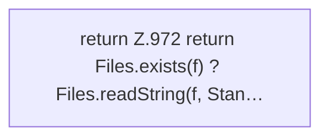

[[00 Start]] › [[Dashboard-HTTP]] › [[API-Antworten]] › [[Dashboard.readOr]]

# Dashboard.readOr

`Dashboard.readOr(Path f)` [src/main/java/de/aichele/childlauncher/Dashboard.java:972–972](https://github.com/Sciddie/minecraft-serverhoster-plugin/blob/95b02b953b0b4c23673e900e021a7c3c844aa37d/src/main/java/de/aichele/childlauncher/Dashboard.java#L972-L972)



```knoten
return Z.972 return Files.exists(f) ? Files.readString(f, Stan…
  Hier endet die [[Glossar#Funktion|Funktion]] und liefert ein Ergebnis zurück. Das steht in [[Glossar#Zeile|Zeile]] 972.
```

> [!knoten]- Was die Blöcke tun
> - **return Z.972 return Files.exists(f) ? Files.readString(f, Stan…**: Hier endet die [[Glossar#Funktion|Funktion]] und liefert ein Ergebnis zurück. Das steht in [[Glossar#Zeile|Zeile]] 972.

- Die [[Glossar#Web-Schnittstelle|Web-Schnittstelle]] liest oder den Ersatz.
