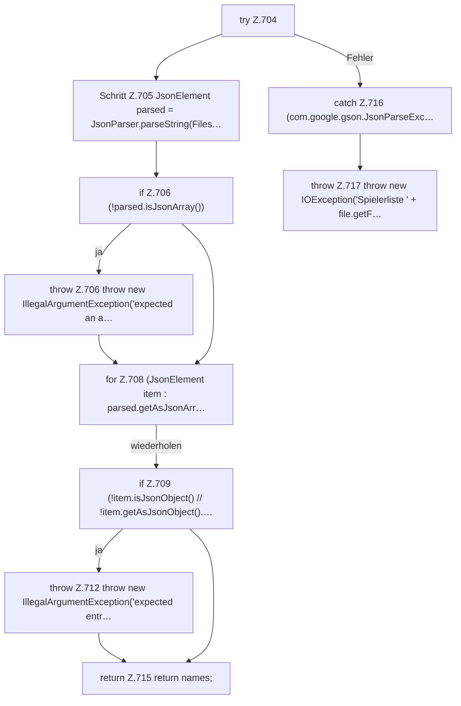

[[00 Start]] › [[Dashboard-HTTP]] › [[API-Spieler]] › [[Dashboard.readPlayerNames]] › [[Dashboard.readPlayerNames.Z704]]

# Dashboard.readPlayerNames.Z704

- Fortsetzung von `Dashboard.readPlayerNames`, Quellreihenfolge.
