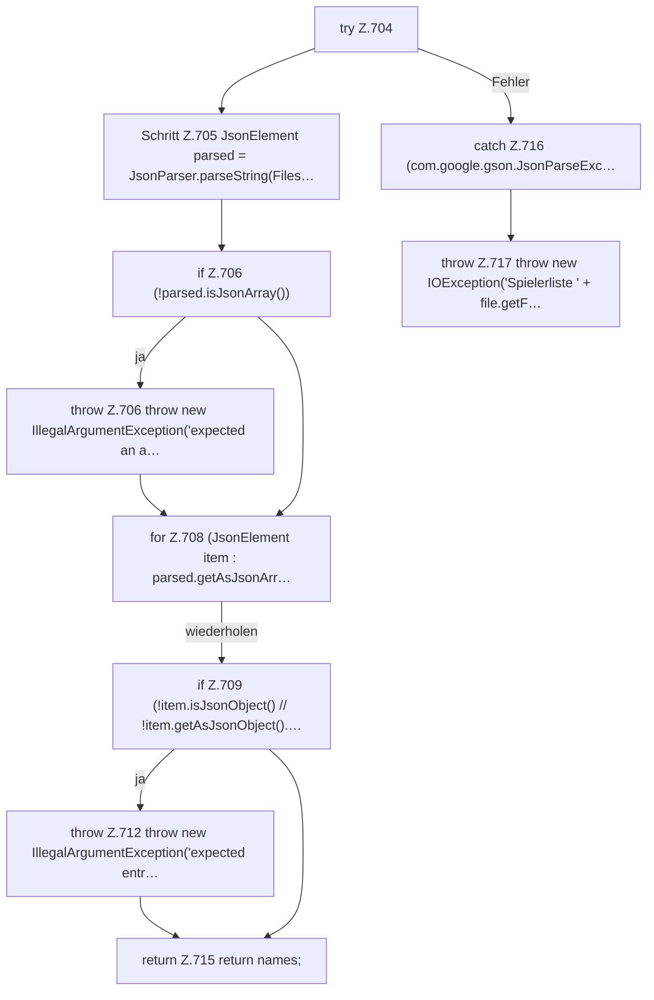

[[00 Start]] › [[Dashboard-HTTP]] › [[API-Spieler]] › [[Dashboard.readPlayerNames]] › [[Dashboard.readPlayerNames.Z704]]

# Dashboard.readPlayerNames.Z704



```knoten
try Z.704
  Zeile 704: Versuch. Der Fehlerpfad geht in catch.
Schritt Z.705 JsonElement parsed = JsonParser.parseString(Files…
  Zeile 705: `JsonElement parsed = JsonParser.parseString(Files…`
if Z.706 (!parsed.isJsonArray())
  Zeile 706: prüft `(!parsed.isJsonArray())`.
throw Z.706 throw new IllegalArgumentException('expected an a…
  Zeile 706: Abbruch `throw new IllegalArgumentException('expected an a…`.
for Z.708 (JsonElement item : parsed.getAsJsonArr…
  Zeile 708: Schleife `(JsonElement item : parsed.getAsJsonArr…`.
if Z.709 (!item.isJsonObject() // !item.getAsJsonObject().…
  Zeile 709: prüft `(!item.isJsonObject() // !item.getAsJsonObject().…`.
throw Z.712 throw new IllegalArgumentException('expected entr…
  Zeile 712: Abbruch `throw new IllegalArgumentException('expected entr…`.
return Z.715 return names;
  Zeile 715: Rückgabe `return names;`.
catch Z.716 (com.google.gson.JsonParseExc…
  Zeile 716: fängt (com.google.gson.JsonParseExc….
throw Z.717 throw new IOException('Spielerliste ' + file.getF…
  Zeile 717: Abbruch `throw new IOException('Spielerliste ' + file.getF…`.
```

> [!knoten]- Was die Blöcke tun
> - **try Z.704**: Zeile 704: Versuch. Der Fehlerpfad geht in catch.
> - **Schritt Z.705 JsonElement parsed = JsonParser.parseString(Files…**: Zeile 705: `JsonElement parsed = JsonParser.parseString(Files…`
> - **if Z.706 (!parsed.isJsonArray())**: Zeile 706: prüft `(!parsed.isJsonArray())`.
> - **throw Z.706 throw new IllegalArgumentException('expected an a…**: Zeile 706: Abbruch `throw new IllegalArgumentException('expected an a…`.
> - **for Z.708 (JsonElement item : parsed.getAsJsonArr…**: Zeile 708: Schleife `(JsonElement item : parsed.getAsJsonArr…`.
> - **if Z.709 (!item.isJsonObject() // !item.getAsJsonObject().…**: Zeile 709: prüft `(!item.isJsonObject() // !item.getAsJsonObject().…`.
> - **throw Z.712 throw new IllegalArgumentException('expected entr…**: Zeile 712: Abbruch `throw new IllegalArgumentException('expected entr…`.
> - **return Z.715 return names;**: Zeile 715: Rückgabe `return names;`.
> - **catch Z.716 (com.google.gson.JsonParseExc…**: Zeile 716: fängt (com.google.gson.JsonParseExc….
> - **throw Z.717 throw new IOException('Spielerliste ' + file.getF…**: Zeile 717: Abbruch `throw new IOException('Spielerliste ' + file.getF…`.

- Der Ablauf geht in [[Glossar#Zeile|Zeile]] 704 weiter. Eine Ebene tiefer steht er genauer.
- Fortsetzung von `Dashboard.readPlayerNames`.
