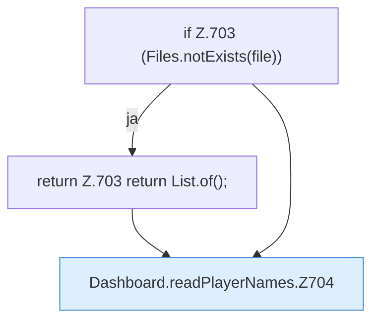

[[00 Start]] › [[Dashboard-HTTP]] › [[API-Spieler]] › [[Dashboard.readPlayerNames]]

# Dashboard.readPlayerNames

`Dashboard.readPlayerNames(Path file)` [src/main/java/de/aichele/childlauncher/Dashboard.java:702–719](https://github.com/Sciddie/minecraft-serverhoster-plugin/blob/95b02b953b0b4c23673e900e021a7c3c844aa37d/src/main/java/de/aichele/childlauncher/Dashboard.java#L702-L719)



```knoten
if Z.703 (Files.notExists(file))
  Zeile 703: prüft `(Files.notExists(file))`.
return Z.703 return List.of();
  Zeile 703: Rückgabe `return List.of();`.
Dashboard.readPlayerNames.Z704
  Fortsetzung des Ablaufs ab Zeile 704.
```

- `readPlayerNames` in `src/main/java/de/aichele/childlauncher/Dashboard.java`
