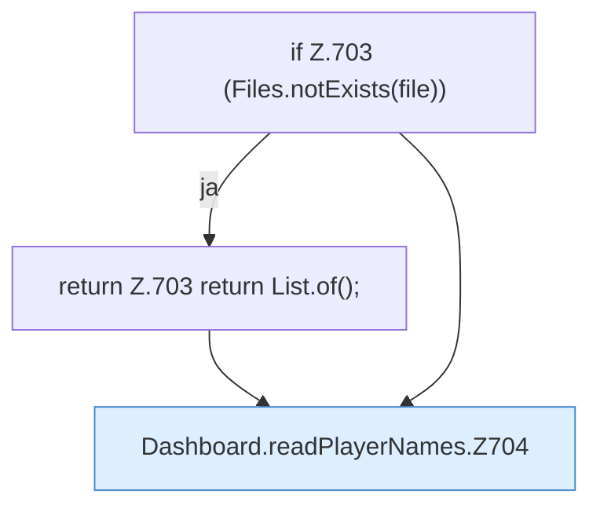

[[00 Start]] › [[Dashboard-HTTP]] › [[API-Spieler]] › [[Dashboard.readPlayerNames]]

# Dashboard.readPlayerNames

`Dashboard.readPlayerNames(Path file)` [src/main/java/de/aichele/childlauncher/Dashboard.java:702–719](https://github.com/Sciddie/minecraft-serverhoster-plugin/blob/95b02b953b0b4c23673e900e021a7c3c844aa37d/src/main/java/de/aichele/childlauncher/Dashboard.java#L702-L719)



```knoten
if Z.703 (Files.notExists(file))
  Hier fällt eine Entscheidung. Nur wenn sie zutrifft, geht es den Ja-Weg weiter. Das steht in [[Glossar#Zeile|Zeile]] 703.
return Z.703 return List.of();
  Hier endet die [[Glossar#Funktion|Funktion]] und liefert ein Ergebnis zurück. Das steht in [[Glossar#Zeile|Zeile]] 703.
Dashboard.readPlayerNames.Z704
  Der Ablauf geht in [[Glossar#Zeile|Zeile]] 704 weiter. Eine Ebene tiefer steht er genauer. Im [[Glossar#Quelltext|Quelltext]] heißt das `Z704`.
```

> [!knoten]- Was die Blöcke tun
> - **if Z.703 (Files.notExists(file))**: Hier fällt eine Entscheidung. Nur wenn sie zutrifft, geht es den Ja-Weg weiter. Das steht in [[Glossar#Zeile|Zeile]] 703.
> - **return Z.703 return List.of();**: Hier endet die [[Glossar#Funktion|Funktion]] und liefert ein Ergebnis zurück. Das steht in [[Glossar#Zeile|Zeile]] 703.
> - **Dashboard.readPlayerNames.Z704**: Der Ablauf geht in [[Glossar#Zeile|Zeile]] 704 weiter. Eine Ebene tiefer steht er genauer. Im [[Glossar#Quelltext|Quelltext]] heißt das `Z704`.

- Die [[Glossar#Web-Schnittstelle|Web-Schnittstelle]] liest den [[Glossar#Spieler|Spieler]] die Namen.
