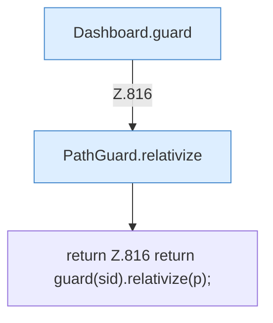

[[00 Start]] › [[Dashboard-HTTP]] › [[API-Dateien]] › [[Dashboard.rel]]

# Dashboard.rel

`Dashboard.rel(String sid, Path p)` [src/main/java/de/aichele/childlauncher/Dashboard.java:816–816](https://github.com/Sciddie/minecraft-serverhoster-plugin/blob/95b02b953b0b4c23673e900e021a7c3c844aa37d/src/main/java/de/aichele/childlauncher/Dashboard.java#L816-L816)



```knoten
Dashboard.guard
  Prüft den Zugriff `guard`. Ruft `open`, `workDir`.
PathGuard.relativize
  `relativize` in `PathGuard.java`.
return Z.816 return guard(sid).relativize(p);
  Zeile 816: Rückgabe `return guard(sid).relativize(p);`.
```

- `rel` in `src/main/java/de/aichele/childlauncher/Dashboard.java`
