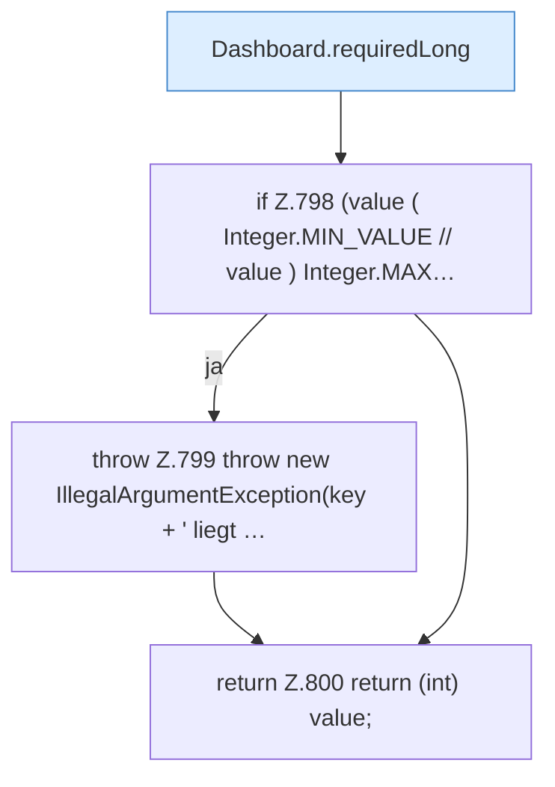

[[00 Start]] › [[Dashboard-HTTP]] › [[API-Setup]] › [[Dashboard.requiredInt]]

# Dashboard.requiredInt

`Dashboard.requiredInt(JsonObject request, String key)` [src/main/java/de/aichele/childlauncher/Dashboard.java:796–801](https://github.com/Sciddie/minecraft-serverhoster-plugin/blob/95b02b953b0b4c23673e900e021a7c3c844aa37d/src/main/java/de/aichele/childlauncher/Dashboard.java#L796-L801)



```knoten
Dashboard.requiredLong
  Liest eine große Zahl, die in der Anfrage dabei sein muss. Im [[Glossar#Quelltext|Quelltext]] heißt das `requiredLong`.
if Z.798 (value ( Integer.MIN_VALUE // value ) Integer.MAX…
  Hier fällt eine Entscheidung. Nur wenn sie zutrifft, geht es den Ja-Weg weiter. Das steht in [[Glossar#Zeile|Zeile]] 798.
throw Z.799 throw new IllegalArgumentException(key + ' liegt …
  Hier bricht die [[Glossar#Funktion|Funktion]] ab, weil etwas nicht geklappt hat. Das steht in [[Glossar#Zeile|Zeile]] 799.
return Z.800 return (int) value;
  Hier endet die [[Glossar#Funktion|Funktion]] und liefert ein Ergebnis zurück. Das steht in [[Glossar#Zeile|Zeile]] 800.
```

> [!knoten]- Was die Blöcke tun
> - **Dashboard.requiredLong**: Liest eine große Zahl, die in der Anfrage dabei sein muss. Im [[Glossar#Quelltext|Quelltext]] heißt das `requiredLong`.
> - **if Z.798 (value ( Integer.MIN_VALUE // value ) Integer.MAX…**: Hier fällt eine Entscheidung. Nur wenn sie zutrifft, geht es den Ja-Weg weiter. Das steht in [[Glossar#Zeile|Zeile]] 798.
> - **throw Z.799 throw new IllegalArgumentException(key + ' liegt …**: Hier bricht die [[Glossar#Funktion|Funktion]] ab, weil etwas nicht geklappt hat. Das steht in [[Glossar#Zeile|Zeile]] 799.
> - **return Z.800 return (int) value;**: Hier endet die [[Glossar#Funktion|Funktion]] und liefert ein Ergebnis zurück. Das steht in [[Glossar#Zeile|Zeile]] 800.

- Liest eine Zahl, die in der Anfrage dabei sein muss.
