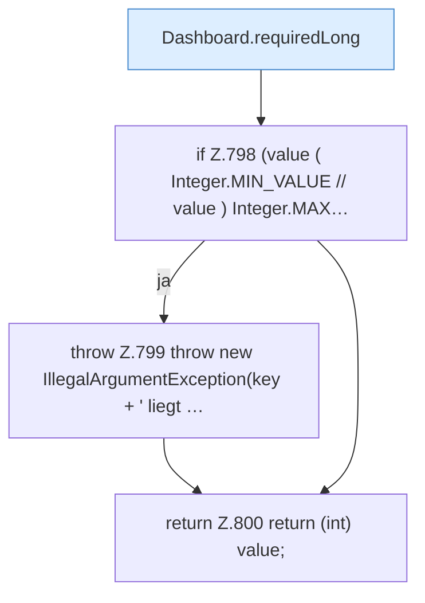

[[00 Start]] › [[Dashboard-HTTP]] › [[API-Setup]] › [[Dashboard.requiredInt]]

# Dashboard.requiredInt

`Dashboard.requiredInt(JsonObject request, String key)` [src/main/java/de/aichele/childlauncher/Dashboard.java:796–801](https://github.com/Sciddie/minecraft-serverhoster-plugin/blob/95b02b953b0b4c23673e900e021a7c3c844aa37d/src/main/java/de/aichele/childlauncher/Dashboard.java#L796-L801)



```knoten
Dashboard.requiredLong
  Liest verpflichtend `requiredLong`.
if Z.798 (value ( Integer.MIN_VALUE // value ) Integer.MAX…
  Zeile 798: prüft `(value ( Integer.MIN_VALUE // value ) Integer.MAX…`.
throw Z.799 throw new IllegalArgumentException(key + ' liegt …
  Zeile 799: Abbruch `throw new IllegalArgumentException(key + ' liegt …`.
return Z.800 return (int) value;
  Zeile 800: Rückgabe `return (int) value;`.
```

- `requiredInt` in `src/main/java/de/aichele/childlauncher/Dashboard.java`
