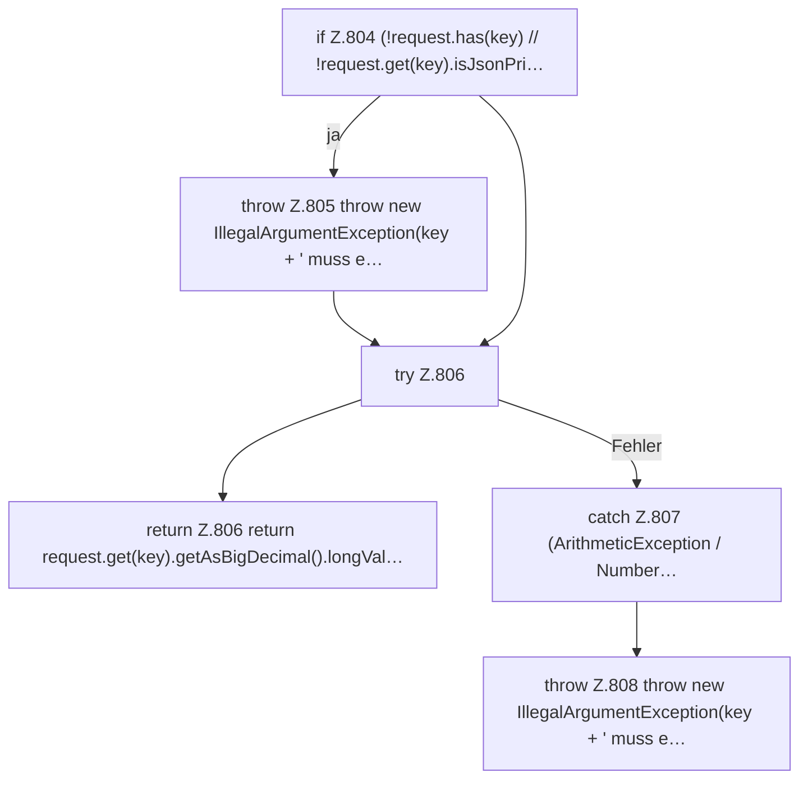

[[00 Start]] › [[Dashboard-HTTP]] › [[API-Setup]] › [[Dashboard.requiredLong]]

# Dashboard.requiredLong

`Dashboard.requiredLong(JsonObject request, String key)` [src/main/java/de/aichele/childlauncher/Dashboard.java:803–810](https://github.com/Sciddie/minecraft-serverhoster-plugin/blob/95b02b953b0b4c23673e900e021a7c3c844aa37d/src/main/java/de/aichele/childlauncher/Dashboard.java#L803-L810)



```knoten
if Z.804 (!request.has(key) // !request.get(key).isJsonPri…
  Hier fällt eine Entscheidung. Nur wenn sie zutrifft, geht es den Ja-Weg weiter. Das steht in [[Glossar#Zeile|Zeile]] 804.
throw Z.805 throw new IllegalArgumentException(key + ' muss e…
  Hier bricht die [[Glossar#Funktion|Funktion]] ab, weil etwas nicht geklappt hat. Das steht in [[Glossar#Zeile|Zeile]] 805.
try Z.806
  Das Programm versucht diesen Schritt. Geht er schief, führt der andere Weg weiter. Das steht in [[Glossar#Zeile|Zeile]] 806.
return Z.806 return request.get(key).getAsBigDecimal().longVal…
  Hier endet die [[Glossar#Funktion|Funktion]] und liefert ein Ergebnis zurück. Das steht in [[Glossar#Zeile|Zeile]] 806.
catch Z.807 (ArithmeticException / Number…
  Dieser Weg gilt, wenn der Schritt davor schiefgegangen ist. Das steht in [[Glossar#Zeile|Zeile]] 807.
throw Z.808 throw new IllegalArgumentException(key + ' muss e…
  Hier bricht die [[Glossar#Funktion|Funktion]] ab, weil etwas nicht geklappt hat. Das steht in [[Glossar#Zeile|Zeile]] 808.
```

> [!knoten]- Was die Blöcke tun
> - **if Z.804 (!request.has(key) // !request.get(key).isJsonPri…**: Hier fällt eine Entscheidung. Nur wenn sie zutrifft, geht es den Ja-Weg weiter. Das steht in [[Glossar#Zeile|Zeile]] 804.
> - **throw Z.805 throw new IllegalArgumentException(key + ' muss e…**: Hier bricht die [[Glossar#Funktion|Funktion]] ab, weil etwas nicht geklappt hat. Das steht in [[Glossar#Zeile|Zeile]] 805.
> - **try Z.806**: Das Programm versucht diesen Schritt. Geht er schief, führt der andere Weg weiter. Das steht in [[Glossar#Zeile|Zeile]] 806.
> - **return Z.806 return request.get(key).getAsBigDecimal().longVal…**: Hier endet die [[Glossar#Funktion|Funktion]] und liefert ein Ergebnis zurück. Das steht in [[Glossar#Zeile|Zeile]] 806.
> - **catch Z.807 (ArithmeticException / Number…**: Dieser Weg gilt, wenn der Schritt davor schiefgegangen ist. Das steht in [[Glossar#Zeile|Zeile]] 807.
> - **throw Z.808 throw new IllegalArgumentException(key + ' muss e…**: Hier bricht die [[Glossar#Funktion|Funktion]] ab, weil etwas nicht geklappt hat. Das steht in [[Glossar#Zeile|Zeile]] 808.

- Liest eine große Zahl, die in der Anfrage dabei sein muss.
