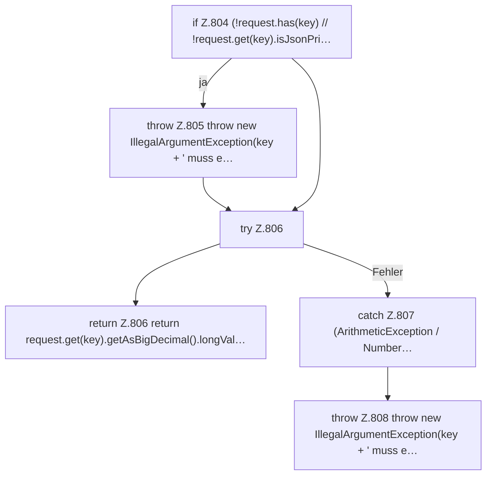

[[00 Start]] › [[Dashboard-HTTP]] › [[API-Setup]] › [[Dashboard.requiredLong]]

# Dashboard.requiredLong

`Dashboard.requiredLong(JsonObject request, String key)` [src/main/java/de/aichele/childlauncher/Dashboard.java:803–810](https://github.com/Sciddie/minecraft-serverhoster-plugin/blob/95b02b953b0b4c23673e900e021a7c3c844aa37d/src/main/java/de/aichele/childlauncher/Dashboard.java#L803-L810)



```knoten
if Z.804 (!request.has(key) // !request.get(key).isJsonPri…
  Zeile 804: prüft `(!request.has(key) // !request.get(key).isJsonPri…`.
throw Z.805 throw new IllegalArgumentException(key + ' muss e…
  Zeile 805: Abbruch `throw new IllegalArgumentException(key + ' muss e…`.
try Z.806
  Zeile 806: Versuch. Der Fehlerpfad geht in catch.
return Z.806 return request.get(key).getAsBigDecimal().longVal…
  Zeile 806: Rückgabe `return request.get(key).getAsBigDecimal().longVal…`.
catch Z.807 (ArithmeticException / Number…
  Zeile 807: fängt (ArithmeticException / Number….
throw Z.808 throw new IllegalArgumentException(key + ' muss e…
  Zeile 808: Abbruch `throw new IllegalArgumentException(key + ' muss e…`.
```

- `requiredLong` in `src/main/java/de/aichele/childlauncher/Dashboard.java`
