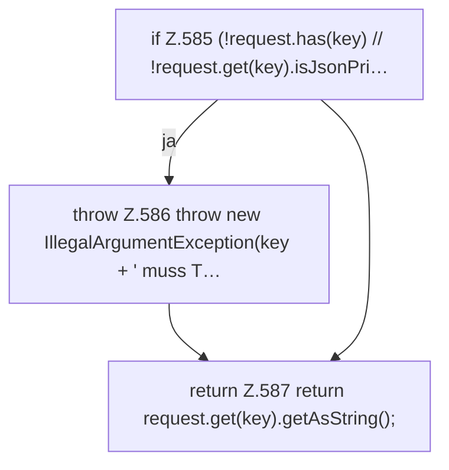

[[00 Start]] › [[Dashboard-HTTP]] › [[API-Setup]] › [[Dashboard.requiredString]]

# Dashboard.requiredString

`Dashboard.requiredString(JsonObject request, String key)` [src/main/java/de/aichele/childlauncher/Dashboard.java:584–588](https://github.com/Sciddie/minecraft-serverhoster-plugin/blob/95b02b953b0b4c23673e900e021a7c3c844aa37d/src/main/java/de/aichele/childlauncher/Dashboard.java#L584-L588)



```knoten
if Z.585 (!request.has(key) // !request.get(key).isJsonPri…
  Hier fällt eine Entscheidung. Nur wenn sie zutrifft, geht es den Ja-Weg weiter. Das steht in [[Glossar#Zeile|Zeile]] 585.
throw Z.586 throw new IllegalArgumentException(key + ' muss T…
  Hier bricht die [[Glossar#Funktion|Funktion]] ab, weil etwas nicht geklappt hat. Das steht in [[Glossar#Zeile|Zeile]] 586.
return Z.587 return request.get(key).getAsString();
  Hier endet die [[Glossar#Funktion|Funktion]] und liefert ein Ergebnis zurück. Das steht in [[Glossar#Zeile|Zeile]] 587.
```

> [!knoten]- Was die Blöcke tun
> - **if Z.585 (!request.has(key) // !request.get(key).isJsonPri…**: Hier fällt eine Entscheidung. Nur wenn sie zutrifft, geht es den Ja-Weg weiter. Das steht in [[Glossar#Zeile|Zeile]] 585.
> - **throw Z.586 throw new IllegalArgumentException(key + ' muss T…**: Hier bricht die [[Glossar#Funktion|Funktion]] ab, weil etwas nicht geklappt hat. Das steht in [[Glossar#Zeile|Zeile]] 586.
> - **return Z.587 return request.get(key).getAsString();**: Hier endet die [[Glossar#Funktion|Funktion]] und liefert ein Ergebnis zurück. Das steht in [[Glossar#Zeile|Zeile]] 587.

- Liest einen Text, der in der Anfrage dabei sein muss.
