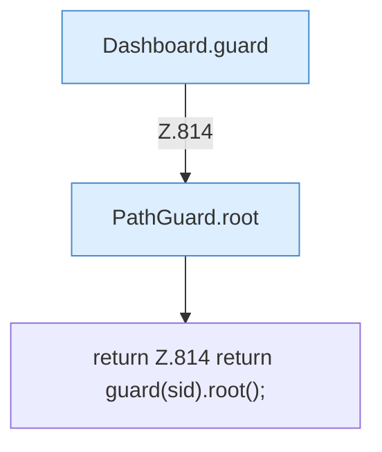

[[00 Start]] › [[Dashboard-HTTP]] › [[API-Dateien]] › [[Dashboard.root]]

# Dashboard.root

`Dashboard.root(String sid)` [src/main/java/de/aichele/childlauncher/Dashboard.java:814–814](https://github.com/Sciddie/minecraft-serverhoster-plugin/blob/95b02b953b0b4c23673e900e021a7c3c844aa37d/src/main/java/de/aichele/childlauncher/Dashboard.java#L814-L814)



```knoten
Dashboard.guard
  Prüft den Zugriff `guard`. Ruft `open`, `workDir`.
PathGuard.root
  Liefert die Wurzel `root`.
return Z.814 return guard(sid).root();
  Zeile 814: Rückgabe `return guard(sid).root();`.
```

- `root` in `src/main/java/de/aichele/childlauncher/Dashboard.java`
