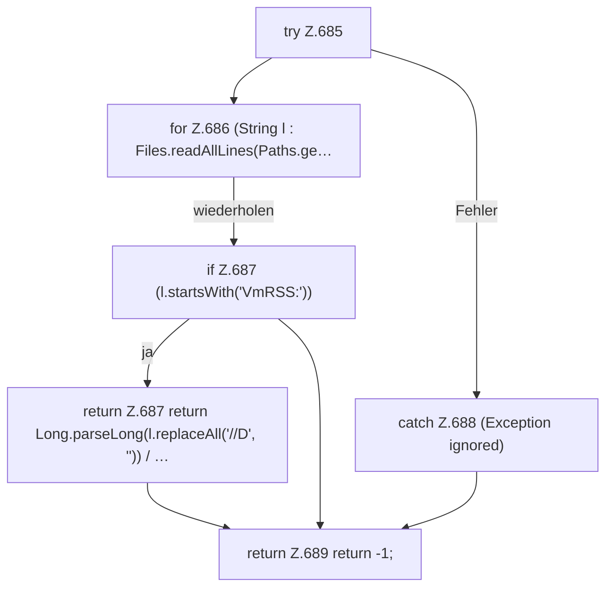

[[00 Start]] › [[Dashboard-HTTP]] › [[API-Status]] › [[Dashboard.rssMb]]

# Dashboard.rssMb

`Dashboard.rssMb(long pid)` [src/main/java/de/aichele/childlauncher/Dashboard.java:684–690](https://github.com/Sciddie/minecraft-serverhoster-plugin/blob/95b02b953b0b4c23673e900e021a7c3c844aa37d/src/main/java/de/aichele/childlauncher/Dashboard.java#L684-L690)



```knoten
try Z.685
  Das Programm versucht diesen Schritt. Geht er schief, führt der andere Weg weiter. Das steht in [[Glossar#Zeile|Zeile]] 685.
for Z.686 (String l : Files.readAllLines(Paths.ge…
  Dasselbe wird für jeden Eintrag wiederholt. Das steht in [[Glossar#Zeile|Zeile]] 686.
if Z.687 (l.startsWith('VmRSS:'))
  Hier fällt eine Entscheidung. Nur wenn sie zutrifft, geht es den Ja-Weg weiter. Das steht in [[Glossar#Zeile|Zeile]] 687.
return Z.687 return Long.parseLong(l.replaceAll('//D', '')) / …
  Hier endet die [[Glossar#Funktion|Funktion]] und liefert ein Ergebnis zurück. Das steht in [[Glossar#Zeile|Zeile]] 687.
catch Z.688 (Exception ignored)
  Dieser Weg gilt, wenn der Schritt davor schiefgegangen ist. Das steht in [[Glossar#Zeile|Zeile]] 688.
return Z.689 return -1;
  Hier endet die [[Glossar#Funktion|Funktion]] und liefert ein Ergebnis zurück. Das steht in [[Glossar#Zeile|Zeile]] 689.
```

> [!knoten]- Was die Blöcke tun
> - **try Z.685**: Das Programm versucht diesen Schritt. Geht er schief, führt der andere Weg weiter. Das steht in [[Glossar#Zeile|Zeile]] 685.
> - **for Z.686 (String l : Files.readAllLines(Paths.ge…**: Dasselbe wird für jeden Eintrag wiederholt. Das steht in [[Glossar#Zeile|Zeile]] 686.
> - **if Z.687 (l.startsWith('VmRSS:'))**: Hier fällt eine Entscheidung. Nur wenn sie zutrifft, geht es den Ja-Weg weiter. Das steht in [[Glossar#Zeile|Zeile]] 687.
> - **return Z.687 return Long.parseLong(l.replaceAll('//D', '')) / …**: Hier endet die [[Glossar#Funktion|Funktion]] und liefert ein Ergebnis zurück. Das steht in [[Glossar#Zeile|Zeile]] 687.
> - **catch Z.688 (Exception ignored)**: Dieser Weg gilt, wenn der Schritt davor schiefgegangen ist. Das steht in [[Glossar#Zeile|Zeile]] 688.
> - **return Z.689 return -1;**: Hier endet die [[Glossar#Funktion|Funktion]] und liefert ein Ergebnis zurück. Das steht in [[Glossar#Zeile|Zeile]] 689.

- Liest, wie viel [[Glossar#Arbeitsspeicher|Arbeitsspeicher]] der [[Glossar#Prozess|Prozess]] gerade belegt.
