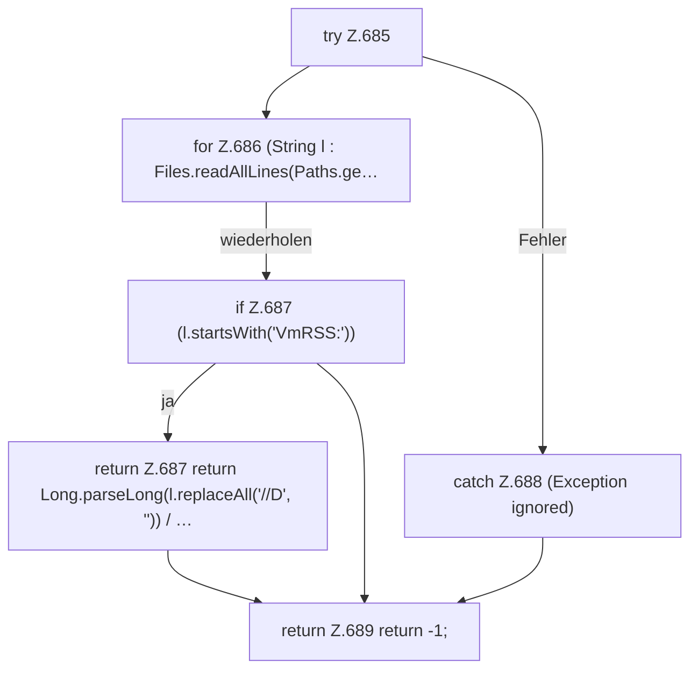

[[00 Start]] › [[Dashboard-HTTP]] › [[API-Status]] › [[Dashboard.rssMb]]

# Dashboard.rssMb

`Dashboard.rssMb(long pid)` [src/main/java/de/aichele/childlauncher/Dashboard.java:684–690](https://github.com/Sciddie/minecraft-serverhoster-plugin/blob/95b02b953b0b4c23673e900e021a7c3c844aa37d/src/main/java/de/aichele/childlauncher/Dashboard.java#L684-L690)

- `rssMb` in `src/main/java/de/aichele/childlauncher/Dashboard.java`
