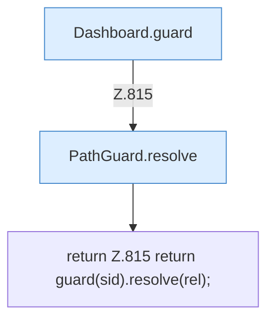

[[00 Start]] › [[Dashboard-HTTP]] › [[API-Dateien]] › [[Dashboard.safe]]

# Dashboard.safe

`Dashboard.safe(String sid, String rel)` [src/main/java/de/aichele/childlauncher/Dashboard.java:815–815](https://github.com/Sciddie/minecraft-serverhoster-plugin/blob/95b02b953b0b4c23673e900e021a7c3c844aa37d/src/main/java/de/aichele/childlauncher/Dashboard.java#L815-L815)



```knoten
Dashboard.guard
  Die [[Glossar#Web-Schnittstelle|Web-Schnittstelle]] macht hier einen einzelnen Schritt. Eine Ebene tiefer steht er genauer. Im [[Glossar#Quelltext|Quelltext]] heißt das `guard`.
PathGuard.resolve
  Dieser Teil bestimmt das. Im [[Glossar#Quelltext|Quelltext]] heißt das `resolve`.
return Z.815 return guard(sid).resolve(rel);
  Hier endet die [[Glossar#Funktion|Funktion]] und liefert ein Ergebnis zurück. Das steht in [[Glossar#Zeile|Zeile]] 815.
```

> [!knoten]- Was die Blöcke tun
> - **Dashboard.guard**: Die [[Glossar#Web-Schnittstelle|Web-Schnittstelle]] macht hier einen einzelnen Schritt. Eine Ebene tiefer steht er genauer. Im [[Glossar#Quelltext|Quelltext]] heißt das `guard`.
> - **PathGuard.resolve**: Dieser Teil bestimmt das. Im [[Glossar#Quelltext|Quelltext]] heißt das `resolve`.
> - **return Z.815 return guard(sid).resolve(rel);**: Hier endet die [[Glossar#Funktion|Funktion]] und liefert ein Ergebnis zurück. Das steht in [[Glossar#Zeile|Zeile]] 815.

- Die [[Glossar#Web-Schnittstelle|Web-Schnittstelle]] macht hier einen einzelnen Schritt. Eine Ebene tiefer steht er genauer.
