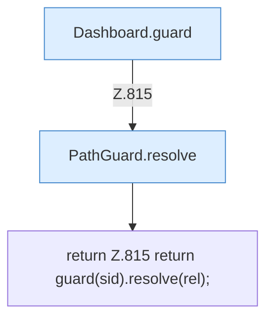

[[00 Start]] › [[Dashboard-HTTP]] › [[API-Dateien]] › [[Dashboard.safe]]

# Dashboard.safe

`Dashboard.safe(String sid, String rel)` [src/main/java/de/aichele/childlauncher/Dashboard.java:815–815](https://github.com/Sciddie/minecraft-serverhoster-plugin/blob/95b02b953b0b4c23673e900e021a7c3c844aa37d/src/main/java/de/aichele/childlauncher/Dashboard.java#L815-L815)

- `safe` in `src/main/java/de/aichele/childlauncher/Dashboard.java`
