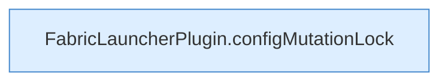

[[00 Start]] › [[Dashboard-HTTP]] › [[API-Setup]] › [[Dashboard.saveConfig]] › [[Dashboard.saveConfig.Aufrufe]]

# Dashboard.saveConfig.Aufrufe

- Fortsetzung von `Dashboard.saveConfig`, Quellreihenfolge.
- ungeprüft: Ablaufparser oder nachgetragene Aufrufe, siehe [[bericht]].
