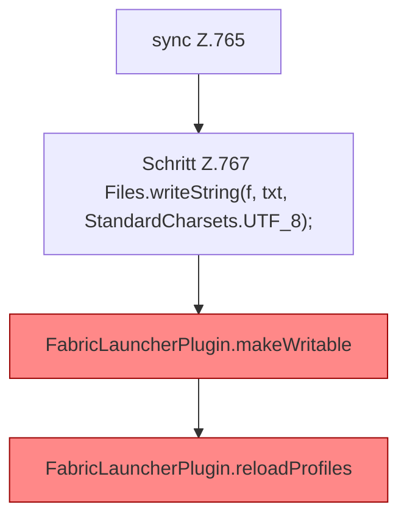

[[00 Start]] › [[Dashboard-HTTP]] › [[API-Setup]] › [[Dashboard.saveConfig]] › [[Dashboard.saveConfig.Teil1.Z765]]

# Dashboard.saveConfig.Teil1.Z765



```knoten
sync Z.765
  Zeile 765: synchronisierter Block.
Schritt Z.767 Files.writeString(f, txt, StandardCharsets.UTF_8);
  Zeile 767: schreibt Text in eine Datei. `Files.writeString(f, txt, StandardCharsets.UTF_8);`
FabricLauncherPlugin.makeWritable
  Setzt POSIX `rwxrwxrwx` für Ordner und `rw-rw-rw-` für Dateien. Befund: Logikrisiko (sicher).
FabricLauncherPlugin.reloadProfiles
  `Profiles.load`, danach nur `getFirst()`. Befund: angemeldet aber nicht umgesetzt (sicher).
```

- Fortsetzung von `Dashboard.saveConfig.Teil1`, Quellreihenfolge.
