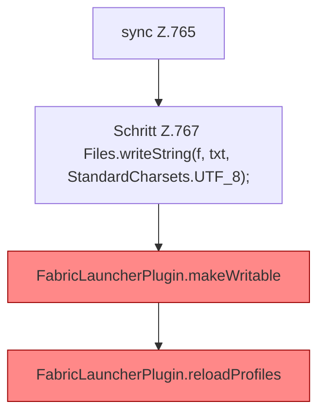

[[00 Start]] › [[Dashboard-HTTP]] › [[API-Setup]] › [[Dashboard.saveConfig]] › [[Dashboard.saveConfig.Teil1.Z765]]

# Dashboard.saveConfig.Teil1.Z765



```knoten
sync Z.765
  Zeile 765: synchronisierter Block.
Schritt Z.767 Files.writeString(f, txt, StandardCharsets.UTF_8);
  Zeile 767: schreibt Text in eine Datei. `Files.writeString(f, txt, StandardCharsets.UTF_8);`
FabricLauncherPlugin.makeWritable
  Setzt die [[Glossar#Dateirechte|Dateirechte]] eines Ordners oder einer Datei sehr offen, damit der [[Glossar#Spielserver|Spielserver]] dort schreiben kann. Setzt POSIX `rwxrwxrwx` für Ordner und `rw-rw-rw-` für Dateien. [[Glossar#Befund|Befund]]: Logikrisiko, sicher. FabricLauncherPlugin.java:241–242 rwxrwxrwx und rw-rw-rw-. Kommentar Z.240 sagt rw für group/other
FabricLauncherPlugin.reloadProfiles
  Liest die Server aus den [[Glossar#Einstellungen|Einstellungen]] neu und behält nur den ersten. `Profiles.load`, danach nur `getFirst()`. [[Glossar#Befund|Befund]]: angemeldet aber nicht umgesetzt, sicher. FabricLauncherPlugin.java:266–272 getFirst verwirft servers.*
```

> [!knoten]- Was die Blöcke tun
> - **sync Z.765**: Zeile 765: synchronisierter Block.
> - **Schritt Z.767 Files.writeString(f, txt, StandardCharsets.UTF_8);**: Zeile 767: schreibt Text in eine Datei. `Files.writeString(f, txt, StandardCharsets.UTF_8);`
> - **FabricLauncherPlugin.makeWritable**: Setzt die [[Glossar#Dateirechte|Dateirechte]] eines Ordners oder einer Datei sehr offen, damit der [[Glossar#Spielserver|Spielserver]] dort schreiben kann. Setzt POSIX `rwxrwxrwx` für Ordner und `rw-rw-rw-` für Dateien. [[Glossar#Befund|Befund]]: Logikrisiko, sicher. FabricLauncherPlugin.java:241–242 rwxrwxrwx und rw-rw-rw-. Kommentar Z.240 sagt rw für group/other
> - **FabricLauncherPlugin.reloadProfiles**: Liest die Server aus den [[Glossar#Einstellungen|Einstellungen]] neu und behält nur den ersten. `Profiles.load`, danach nur `getFirst()`. [[Glossar#Befund|Befund]]: angemeldet aber nicht umgesetzt, sicher. FabricLauncherPlugin.java:266–272 getFirst verwirft servers.*

- Der Ablauf geht in [[Glossar#Zeile|Zeile]] 765 weiter. Eine Ebene tiefer steht er genauer.
- Fortsetzung von `Dashboard.saveConfig.Teil1`.
