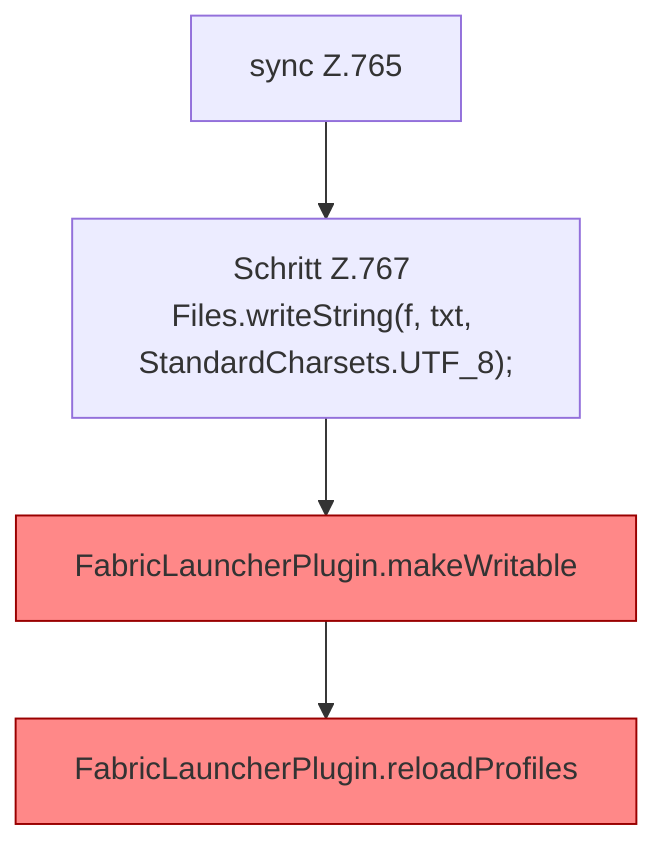

[[00 Start]] › [[Dashboard-HTTP]] › [[API-Setup]] › [[Dashboard.saveConfig]] › [[Dashboard.saveConfig.Teil1.Z765]]

# Dashboard.saveConfig.Teil1.Z765

- Fortsetzung von `Dashboard.saveConfig.Teil1`, Quellreihenfolge.
