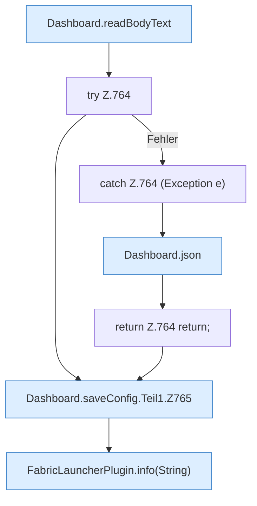

[[00 Start]] › [[Dashboard-HTTP]] › [[API-Setup]] › [[Dashboard.saveConfig]] › [[Dashboard.saveConfig.Teil1]]

# Dashboard.saveConfig.Teil1

- Fortsetzung von `Dashboard.saveConfig`, Quellreihenfolge.
