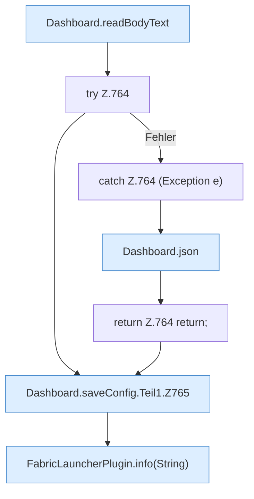

[[00 Start]] › [[Dashboard-HTTP]] › [[API-Setup]] › [[Dashboard.saveConfig]] › [[Dashboard.saveConfig.Teil1]]

# Dashboard.saveConfig.Teil1



```knoten
Dashboard.readBodyText
  Liest `readBodyText`.
try Z.764
  Zeile 764: Versuch. Der Fehlerpfad geht in catch.
catch Z.764 (Exception e)
  Zeile 764: fängt (Exception e).
Dashboard.json
  Antwortet mit JSON `json`. Ruft `sendBytes`.
return Z.764 return;
  Zeile 764: Rückgabe `return;`.
Dashboard.saveConfig.Teil1.Z765
  Fortsetzung des Ablaufs ab Zeile 765.
FabricLauncherPlugin.info(String)
  Schreibt eine Infozeile `info`. Ruft `info`.
```

- Fortsetzung von `Dashboard.saveConfig`, Quellreihenfolge.
