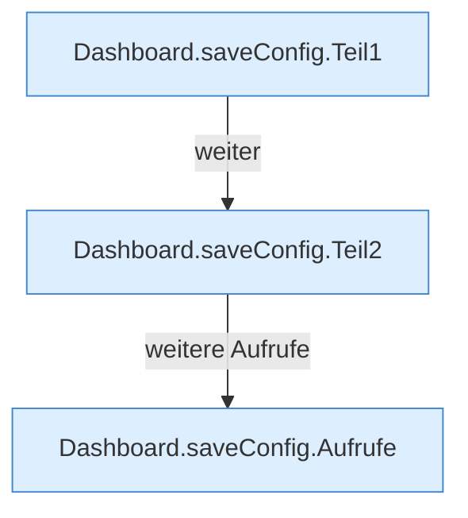

[[00 Start]] › [[Dashboard-HTTP]] › [[API-Setup]] › [[Dashboard.saveConfig]]

# Dashboard.saveConfig

`Dashboard.saveConfig(HttpExchange ex)` [src/main/java/de/aichele/childlauncher/Dashboard.java:761–774](https://github.com/Sciddie/minecraft-serverhoster-plugin/blob/95b02b953b0b4c23673e900e021a7c3c844aa37d/src/main/java/de/aichele/childlauncher/Dashboard.java#L761-L774)



```knoten
Dashboard.saveConfig.Teil1
  Ein weiterer Abschnitt derselben Übersicht. Im [[Glossar#Quelltext|Quelltext]] heißt das `Teil1`.
Dashboard.saveConfig.Teil2
  Ein weiterer Abschnitt derselben Übersicht. Im [[Glossar#Quelltext|Quelltext]] heißt das `Teil2`.
Dashboard.saveConfig.Aufrufe
  Aufrufe, die das Diagramm nicht in den gezeichneten Ablauf gesetzt hat. Im [[Glossar#Quelltext|Quelltext]] heißt das `Aufrufe`.
```

> [!knoten]- Was die Blöcke tun
> - **Dashboard.saveConfig.Teil1**: Ein weiterer Abschnitt derselben Übersicht. Im [[Glossar#Quelltext|Quelltext]] heißt das `Teil1`.
> - **Dashboard.saveConfig.Teil2**: Ein weiterer Abschnitt derselben Übersicht. Im [[Glossar#Quelltext|Quelltext]] heißt das `Teil2`.
> - **Dashboard.saveConfig.Aufrufe**: Aufrufe, die das Diagramm nicht in den gezeichneten Ablauf gesetzt hat. Im [[Glossar#Quelltext|Quelltext]] heißt das `Aufrufe`.

- Die [[Glossar#Web-Schnittstelle|Web-Schnittstelle]] speichert die [[Glossar#Einstellungen|Einstellungen]].
- ungeprüft: Ablaufparser oder nachgetragene Aufrufe, siehe [[bericht]].
