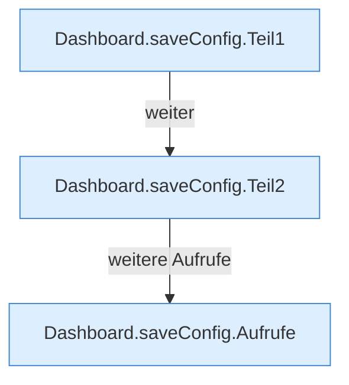

[[00 Start]] › [[Dashboard-HTTP]] › [[API-Setup]] › [[Dashboard.saveConfig]]

# Dashboard.saveConfig

`Dashboard.saveConfig(HttpExchange ex)` [src/main/java/de/aichele/childlauncher/Dashboard.java:761–774](https://github.com/Sciddie/minecraft-serverhoster-plugin/blob/95b02b953b0b4c23673e900e021a7c3c844aa37d/src/main/java/de/aichele/childlauncher/Dashboard.java#L761-L774)



```knoten
Dashboard.saveConfig.Teil1
  Abschnitt 1 dieses Ablaufs, in Quellreihenfolge.
Dashboard.saveConfig.Teil2
  Abschnitt 2 dieses Ablaufs, in Quellreihenfolge.
Dashboard.saveConfig.Aufrufe
  Eigene Aufrufe, die der Parser nicht in den gezeichneten Ablauf gesetzt hat.
```

- `saveConfig` in `src/main/java/de/aichele/childlauncher/Dashboard.java`
- ungeprüft: Ablaufparser oder nachgetragene Aufrufe, siehe [[bericht]].
