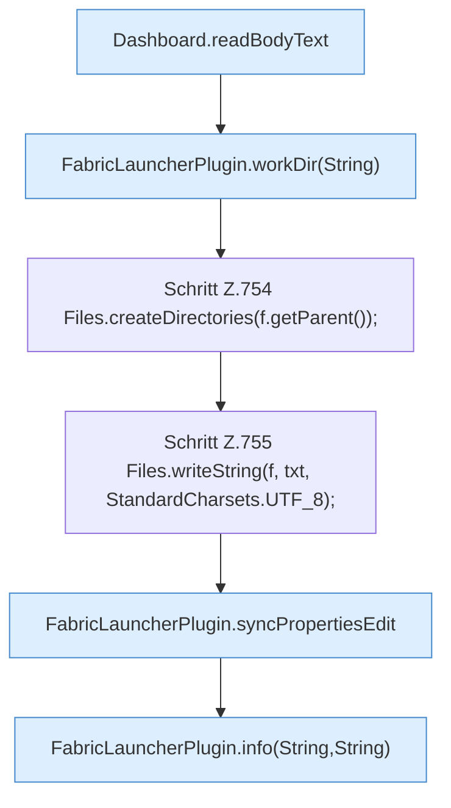

[[00 Start]] › [[Dashboard-HTTP]] › [[API-Setup]] › [[Dashboard.saveProps]] › [[Dashboard.saveProps.Teil1]]

# Dashboard.saveProps.Teil1



```knoten
Dashboard.readBodyText
  Die [[Glossar#Web-Schnittstelle|Web-Schnittstelle]] liest den Text den Text. Liest `readBodyText`.
FabricLauncherPlugin.workDir(String)
  Liefert den Ordner, in dem der [[Glossar#Spielserver|Spielserver]] arbeitet. `workDir` in `FabricLauncherPlugin.java`. Ruft `profile`, `directory`.
Schritt Z.754 Files.createDirectories(f.getParent());
  Zeile 754: Dateioperation. `Files.createDirectories(f.getParent());`
Schritt Z.755 Files.writeString(f, txt, StandardCharsets.UTF_8);
  Zeile 755: schreibt Text in eine Datei. `Files.writeString(f, txt, StandardCharsets.UTF_8);`
FabricLauncherPlugin.syncPropertiesEdit
  Das [[Glossar#Plugin|Plugin]] gleicht ab die Eigenschaften die Bearbeitung. Gleicht ab `syncPropertiesEdit`. Ruft `profile`, `configPrefix`, `parseValue`.
FabricLauncherPlugin.info(String,String)
  Schreibt eine Hinweiszeile in die [[Glossar#Konsole|Konsole]] des [[Glossar#Spielserver|Spielservers]]. Schreibt eine Infozeile `info`. Ruft `slot`.
```

> [!knoten]- Was die Blöcke tun
> - **Dashboard.readBodyText**: Die [[Glossar#Web-Schnittstelle|Web-Schnittstelle]] liest den Text den Text. Liest `readBodyText`.
> - **FabricLauncherPlugin.workDir(String)**: Liefert den Ordner, in dem der [[Glossar#Spielserver|Spielserver]] arbeitet. `workDir` in `FabricLauncherPlugin.java`. Ruft `profile`, `directory`.
> - **Schritt Z.754 Files.createDirectories(f.getParent());**: Zeile 754: Dateioperation. `Files.createDirectories(f.getParent());`
> - **Schritt Z.755 Files.writeString(f, txt, StandardCharsets.UTF_8);**: Zeile 755: schreibt Text in eine Datei. `Files.writeString(f, txt, StandardCharsets.UTF_8);`
> - **FabricLauncherPlugin.syncPropertiesEdit**: Das [[Glossar#Plugin|Plugin]] gleicht ab die Eigenschaften die Bearbeitung. Gleicht ab `syncPropertiesEdit`. Ruft `profile`, `configPrefix`, `parseValue`.
> - **FabricLauncherPlugin.info(String,String)**: Schreibt eine Hinweiszeile in die [[Glossar#Konsole|Konsole]] des [[Glossar#Spielserver|Spielservers]]. Schreibt eine Infozeile `info`. Ruft `slot`.

- Ein weiterer Abschnitt derselben Übersicht.
- Fortsetzung von `Dashboard.saveProps`.
