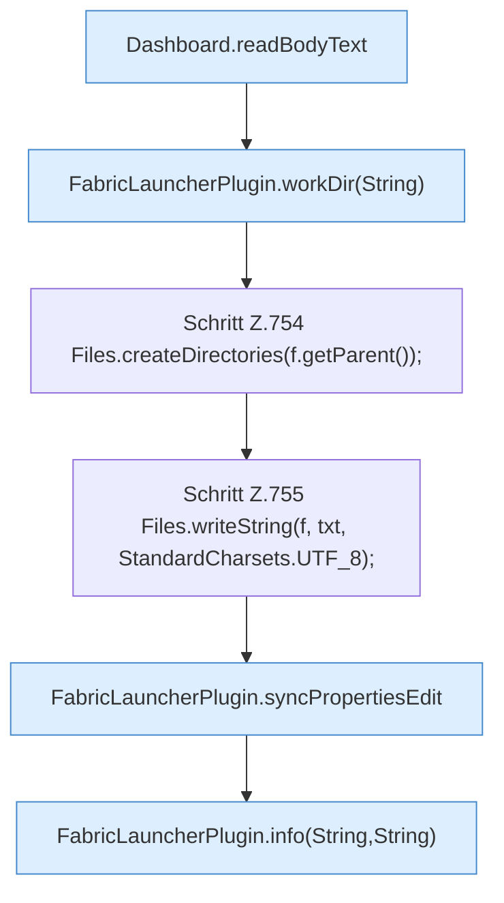

[[00 Start]] › [[Dashboard-HTTP]] › [[API-Setup]] › [[Dashboard.saveProps]] › [[Dashboard.saveProps.Teil1]]

# Dashboard.saveProps.Teil1



```knoten
Dashboard.readBodyText
  Liest `readBodyText`.
FabricLauncherPlugin.workDir(String)
  `workDir` in `FabricLauncherPlugin.java`. Ruft `profile`, `directory`.
Schritt Z.754 Files.createDirectories(f.getParent());
  Zeile 754: Dateioperation. `Files.createDirectories(f.getParent());`
Schritt Z.755 Files.writeString(f, txt, StandardCharsets.UTF_8);
  Zeile 755: schreibt Text in eine Datei. `Files.writeString(f, txt, StandardCharsets.UTF_8);`
FabricLauncherPlugin.syncPropertiesEdit
  Gleicht ab `syncPropertiesEdit`. Ruft `profile`, `configPrefix`, `parseValue`.
FabricLauncherPlugin.info(String,String)
  Schreibt eine Infozeile `info`. Ruft `slot`.
```

- Fortsetzung von `Dashboard.saveProps`, Quellreihenfolge.
