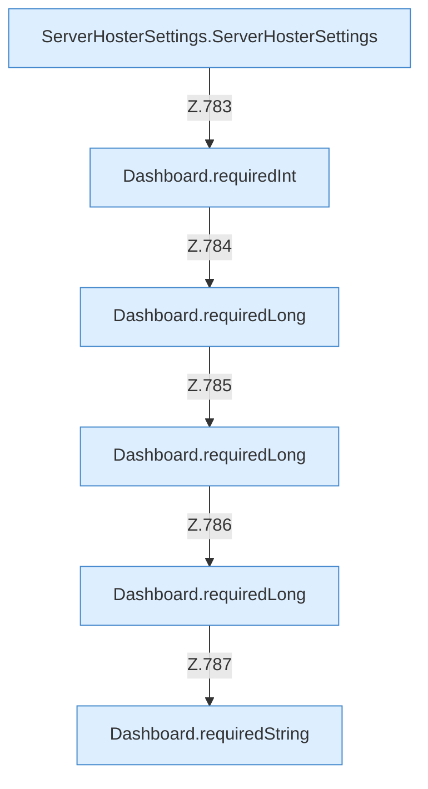

[[00 Start]] › [[Dashboard-HTTP]] › [[API-Setup]] › [[Dashboard.saveSettings]] › [[Dashboard.saveSettings.Teil1.Calls42317]]

# Dashboard.saveSettings.Teil1.Calls42317



```knoten
ServerHosterSettings.ServerHosterSettings
  Dieser Teil kümmert sich um das [[Glossar#Plugin|Plugin]] die [[Glossar#Einstellungen|Einstellungen]]. `ServerHosterSettings` in `ServerHosterSettings.java`. Ruft `maxAttempts`, `enumValue`, `hasUnsafeHostCharacter`.
Dashboard.requiredInt
  Liest eine Zahl, die in der Anfrage dabei sein muss. Liest verpflichtend `requiredInt`. Ruft `requiredLong`.
Dashboard.requiredLong
  Liest eine große Zahl, die in der Anfrage dabei sein muss. Liest verpflichtend `requiredLong`.
Dashboard.requiredString
  Liest einen Text, der in der Anfrage dabei sein muss. Liest verpflichtend `requiredString`.
```

> [!knoten]- Was die Blöcke tun
> - **ServerHosterSettings.ServerHosterSettings**: Dieser Teil kümmert sich um das [[Glossar#Plugin|Plugin]] die [[Glossar#Einstellungen|Einstellungen]]. `ServerHosterSettings` in `ServerHosterSettings.java`. Ruft `maxAttempts`, `enumValue`, `hasUnsafeHostCharacter`.
> - **Dashboard.requiredInt**: Liest eine Zahl, die in der Anfrage dabei sein muss. Liest verpflichtend `requiredInt`. Ruft `requiredLong`.
> - **Dashboard.requiredLong**: Liest eine große Zahl, die in der Anfrage dabei sein muss. Liest verpflichtend `requiredLong`.
> - **Dashboard.requiredString**: Liest einen Text, der in der Anfrage dabei sein muss. Liest verpflichtend `requiredString`.

- Weitere [[Glossar#Funktion|Funktionen]], die ab [[Glossar#Zeile|Zeile]] 42317 aufgerufen werden.
- Fortsetzung von `Dashboard.saveSettings.Teil1`.
