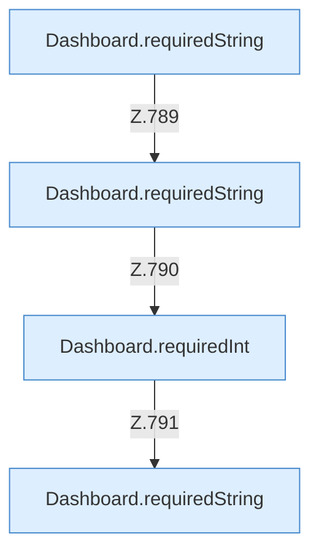

[[00 Start]] › [[Dashboard-HTTP]] › [[API-Setup]] › [[Dashboard.saveSettings]] › [[Dashboard.saveSettings.Teil1.Calls42744]]

# Dashboard.saveSettings.Teil1.Calls42744



```knoten
Dashboard.requiredString
  Liest einen Text, der in der Anfrage dabei sein muss. Liest verpflichtend `requiredString`.
Dashboard.requiredInt
  Liest eine Zahl, die in der Anfrage dabei sein muss. Liest verpflichtend `requiredInt`. Ruft `requiredLong`.
```

> [!knoten]- Was die Blöcke tun
> - **Dashboard.requiredString**: Liest einen Text, der in der Anfrage dabei sein muss. Liest verpflichtend `requiredString`.
> - **Dashboard.requiredInt**: Liest eine Zahl, die in der Anfrage dabei sein muss. Liest verpflichtend `requiredInt`. Ruft `requiredLong`.

- Weitere [[Glossar#Funktion|Funktionen]], die ab [[Glossar#Zeile|Zeile]] 42744 aufgerufen werden.
- Fortsetzung von `Dashboard.saveSettings.Teil1`.
