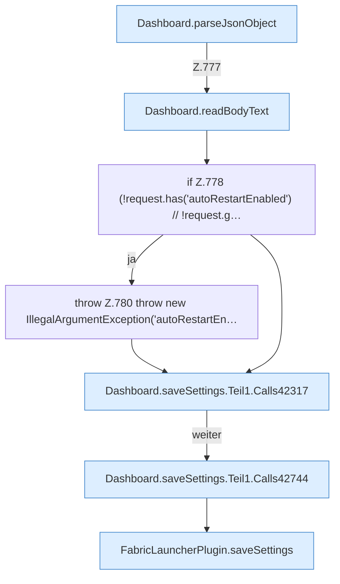

[[00 Start]] › [[Dashboard-HTTP]] › [[API-Setup]] › [[Dashboard.saveSettings]] › [[Dashboard.saveSettings.Teil1]]

# Dashboard.saveSettings.Teil1



```knoten
Dashboard.parseJsonObject
  Die [[Glossar#Web-Schnittstelle|Web-Schnittstelle]] liest die Antwort den Inhalt. Wertet aus `parseJsonObject`.
Dashboard.readBodyText
  Die [[Glossar#Web-Schnittstelle|Web-Schnittstelle]] liest den Text den Text. Liest `readBodyText`.
if Z.778 (!request.has('autoRestartEnabled') // !request.g…
  Zeile 778: prüft `(!request.has('autoRestartEnabled') // !request.g…`.
throw Z.780 throw new IllegalArgumentException('autoRestartEn…
  Zeile 780: Abbruch `throw new IllegalArgumentException('autoRestartEn…`.
Dashboard.saveSettings.Teil1.Calls42317
  Weitere [[Glossar#Funktion|Funktionen]], die ab [[Glossar#Zeile|Zeile]] 42317 aufgerufen werden. Weitere eigene Aufrufe ab Zeile 42317.
Dashboard.saveSettings.Teil1.Calls42744
  Weitere [[Glossar#Funktion|Funktionen]], die ab [[Glossar#Zeile|Zeile]] 42744 aufgerufen werden. Weitere eigene Aufrufe ab Zeile 42744.
FabricLauncherPlugin.saveSettings
  Das [[Glossar#Plugin|Plugin]] speichert die [[Glossar#Einstellungen|Einstellungen]]. Speichert `saveSettings`. Ruft `apply`, `saveConfigWritable`.
```

> [!knoten]- Was die Blöcke tun
> - **Dashboard.parseJsonObject**: Die [[Glossar#Web-Schnittstelle|Web-Schnittstelle]] liest die Antwort den Inhalt. Wertet aus `parseJsonObject`.
> - **Dashboard.readBodyText**: Die [[Glossar#Web-Schnittstelle|Web-Schnittstelle]] liest den Text den Text. Liest `readBodyText`.
> - **if Z.778 (!request.has('autoRestartEnabled') // !request.g…**: Zeile 778: prüft `(!request.has('autoRestartEnabled') // !request.g…`.
> - **throw Z.780 throw new IllegalArgumentException('autoRestartEn…**: Zeile 780: Abbruch `throw new IllegalArgumentException('autoRestartEn…`.
> - **Dashboard.saveSettings.Teil1.Calls42317**: Weitere [[Glossar#Funktion|Funktionen]], die ab [[Glossar#Zeile|Zeile]] 42317 aufgerufen werden. Weitere eigene Aufrufe ab Zeile 42317.
> - **Dashboard.saveSettings.Teil1.Calls42744**: Weitere [[Glossar#Funktion|Funktionen]], die ab [[Glossar#Zeile|Zeile]] 42744 aufgerufen werden. Weitere eigene Aufrufe ab Zeile 42744.
> - **FabricLauncherPlugin.saveSettings**: Das [[Glossar#Plugin|Plugin]] speichert die [[Glossar#Einstellungen|Einstellungen]]. Speichert `saveSettings`. Ruft `apply`, `saveConfigWritable`.

- Ein weiterer Abschnitt derselben Übersicht.
- Fortsetzung von `Dashboard.saveSettings`.
