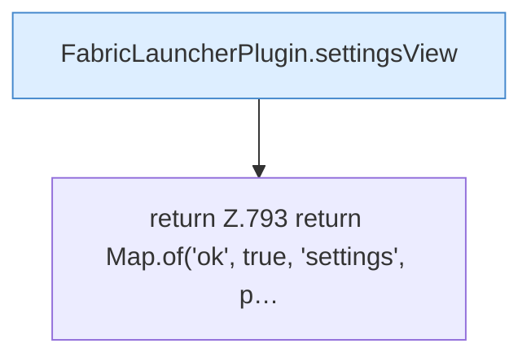

[[00 Start]] › [[Dashboard-HTTP]] › [[API-Setup]] › [[Dashboard.saveSettings]] › [[Dashboard.saveSettings.Teil2]]

# Dashboard.saveSettings.Teil2

- Fortsetzung von `Dashboard.saveSettings`, Quellreihenfolge.
