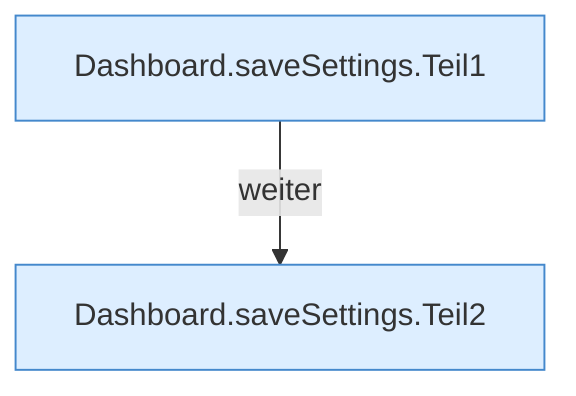

[[00 Start]] › [[Dashboard-HTTP]] › [[API-Setup]] › [[Dashboard.saveSettings]]

# Dashboard.saveSettings

`Dashboard.saveSettings(HttpExchange ex)` [src/main/java/de/aichele/childlauncher/Dashboard.java:776–794](https://github.com/Sciddie/minecraft-serverhoster-plugin/blob/95b02b953b0b4c23673e900e021a7c3c844aa37d/src/main/java/de/aichele/childlauncher/Dashboard.java#L776-L794)



```knoten
Dashboard.saveSettings.Teil1
  Abschnitt 1 dieses Ablaufs, in Quellreihenfolge.
Dashboard.saveSettings.Teil2
  Abschnitt 2 dieses Ablaufs, in Quellreihenfolge.
```

- `saveSettings` in `src/main/java/de/aichele/childlauncher/Dashboard.java`
