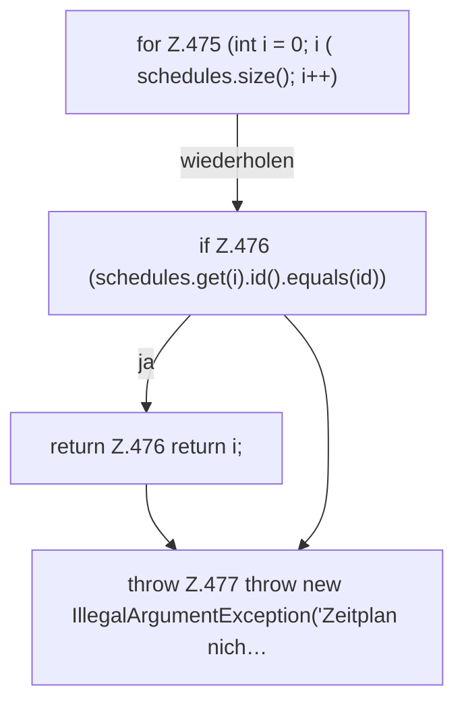

[[00 Start]] › [[Dashboard-HTTP]] › [[API-Zeit]] › [[Dashboard.scheduleIndex]]

# Dashboard.scheduleIndex

`Dashboard.scheduleIndex(List<ScheduleDef> schedules, String id)` [src/main/java/de/aichele/childlauncher/Dashboard.java:474–478](https://github.com/Sciddie/minecraft-serverhoster-plugin/blob/95b02b953b0b4c23673e900e021a7c3c844aa37d/src/main/java/de/aichele/childlauncher/Dashboard.java#L474-L478)



```knoten
for Z.475 (int i = 0; i ( schedules.size(); i++)
  Zeile 475: Schleife `(int i = 0; i ( schedules.size(); i++)`.
if Z.476 (schedules.get(i).id().equals(id))
  Zeile 476: prüft `(schedules.get(i).id().equals(id))`.
return Z.476 return i;
  Zeile 476: Rückgabe `return i;`.
throw Z.477 throw new IllegalArgumentException('Zeitplan nich…
  Zeile 477: Abbruch `throw new IllegalArgumentException('Zeitplan nich…`.
```

- `scheduleIndex` in `src/main/java/de/aichele/childlauncher/Dashboard.java`
