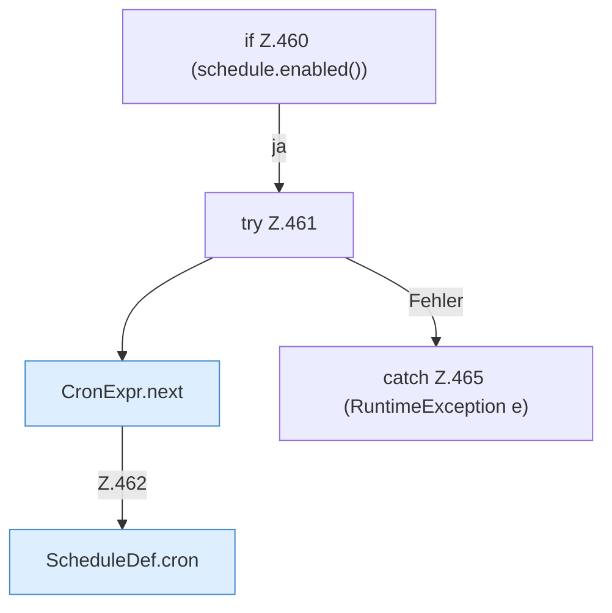

[[00 Start]] › [[Dashboard-HTTP]] › [[API-Zeit]] › [[Dashboard.scheduleJson]] › [[Dashboard.scheduleJson.Z460]]

# Dashboard.scheduleJson.Z460

- Fortsetzung von `Dashboard.scheduleJson`, Quellreihenfolge.
