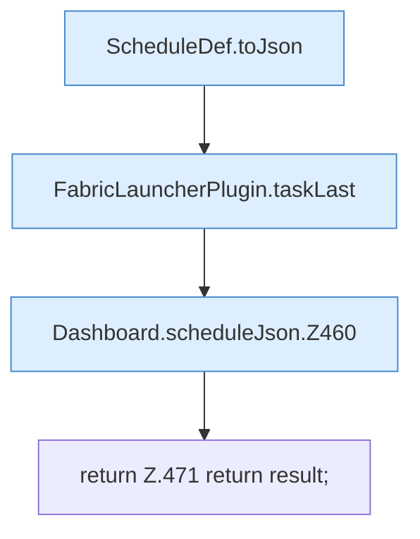

[[00 Start]] › [[Dashboard-HTTP]] › [[API-Zeit]] › [[Dashboard.scheduleJson]]

# Dashboard.scheduleJson

`Dashboard.scheduleJson(ScheduleDef schedule)` [src/main/java/de/aichele/childlauncher/Dashboard.java:457–472](https://github.com/Sciddie/minecraft-serverhoster-plugin/blob/95b02b953b0b4c23673e900e021a7c3c844aa37d/src/main/java/de/aichele/childlauncher/Dashboard.java#L457-L472)



```knoten
ScheduleDef.toJson
  Der [[Glossar#Zeitplan|Zeitplan]] kümmert sich um die Antwort. Im [[Glossar#Quelltext|Quelltext]] heißt das `toJson`.
FabricLauncherPlugin.taskLast
  Merkt, wann eine [[Glossar#Aufgabe|Aufgabe]] zuletzt gelaufen ist. Im [[Glossar#Quelltext|Quelltext]] heißt das `taskLast`.
Dashboard.scheduleJson.Z460
  Der Ablauf geht in [[Glossar#Zeile|Zeile]] 460 weiter. Eine Ebene tiefer steht er genauer. Im [[Glossar#Quelltext|Quelltext]] heißt das `Z460`.
return Z.471 return result;
  Hier endet die [[Glossar#Funktion|Funktion]] und liefert ein Ergebnis zurück. Das steht in [[Glossar#Zeile|Zeile]] 471.
```

> [!knoten]- Was die Blöcke tun
> - **ScheduleDef.toJson**: Der [[Glossar#Zeitplan|Zeitplan]] kümmert sich um die Antwort. Im [[Glossar#Quelltext|Quelltext]] heißt das `toJson`.
> - **FabricLauncherPlugin.taskLast**: Merkt, wann eine [[Glossar#Aufgabe|Aufgabe]] zuletzt gelaufen ist. Im [[Glossar#Quelltext|Quelltext]] heißt das `taskLast`.
> - **Dashboard.scheduleJson.Z460**: Der Ablauf geht in [[Glossar#Zeile|Zeile]] 460 weiter. Eine Ebene tiefer steht er genauer. Im [[Glossar#Quelltext|Quelltext]] heißt das `Z460`.
> - **return Z.471 return result;**: Hier endet die [[Glossar#Funktion|Funktion]] und liefert ein Ergebnis zurück. Das steht in [[Glossar#Zeile|Zeile]] 471.

- Die [[Glossar#Web-Schnittstelle|Web-Schnittstelle]] plant die Antwort.
