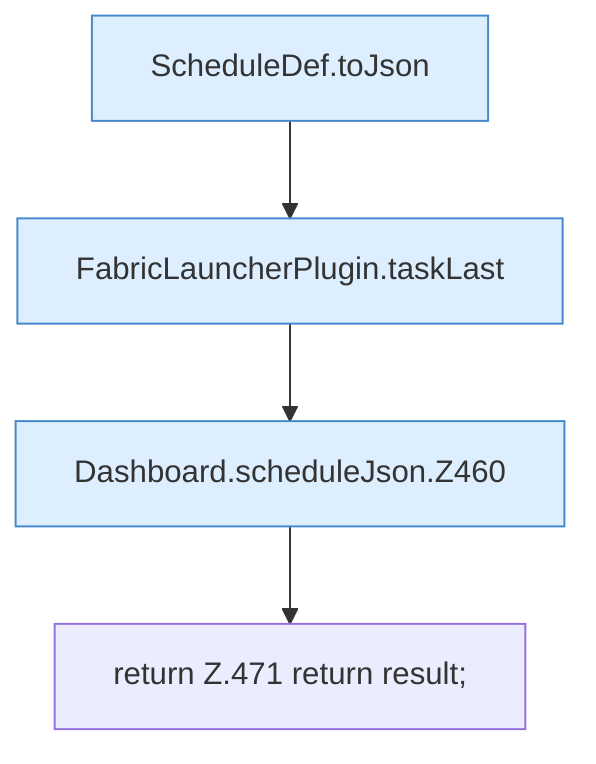

[[00 Start]] › [[Dashboard-HTTP]] › [[API-Zeit]] › [[Dashboard.scheduleJson]]

# Dashboard.scheduleJson

`Dashboard.scheduleJson(ScheduleDef schedule)` [src/main/java/de/aichele/childlauncher/Dashboard.java:457–472](https://github.com/Sciddie/minecraft-serverhoster-plugin/blob/95b02b953b0b4c23673e900e021a7c3c844aa37d/src/main/java/de/aichele/childlauncher/Dashboard.java#L457-L472)



```knoten
ScheduleDef.toJson
  `toJson` in `ScheduleDef.java`. Ruft `toConfig`, `cron`.
FabricLauncherPlugin.taskLast
  `taskLast` in `FabricLauncherPlugin.java`.
Dashboard.scheduleJson.Z460
  Fortsetzung des Ablaufs ab Zeile 460.
return Z.471 return result;
  Zeile 471: Rückgabe `return result;`.
```

- `scheduleJson` in `src/main/java/de/aichele/childlauncher/Dashboard.java`
