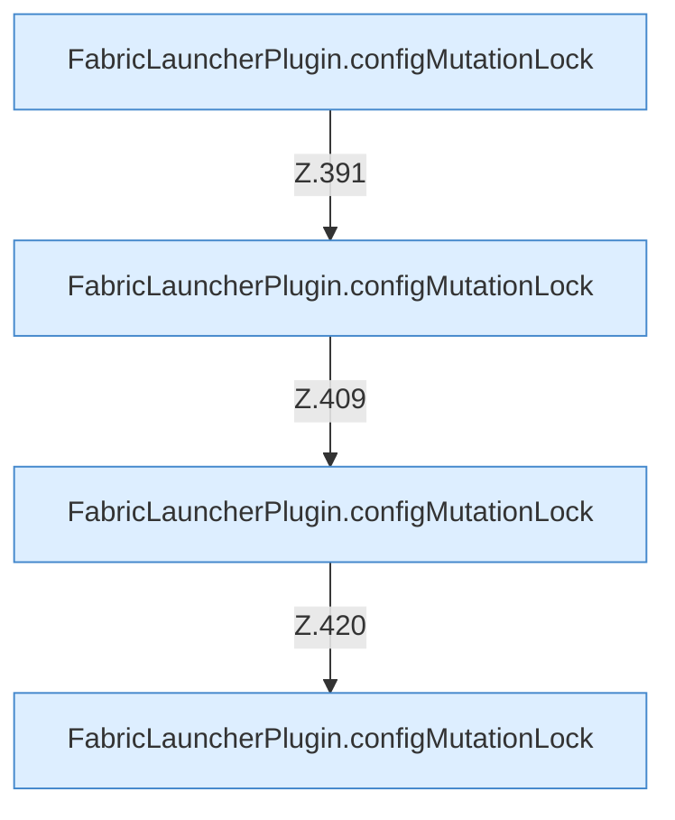

[[00 Start]] › [[Dashboard-HTTP]] › [[API-Zeit]] › [[Dashboard.schedulesApi]] › [[Dashboard.schedulesApi.Aufrufe]]

# Dashboard.schedulesApi.Aufrufe



```knoten
FabricLauncherPlugin.configMutationLock
  `configMutationLock` in `FabricLauncherPlugin.java`.
```

- Fortsetzung von `Dashboard.schedulesApi`, Quellreihenfolge.
- ungeprüft: Ablaufparser oder nachgetragene Aufrufe, siehe [[bericht]].
