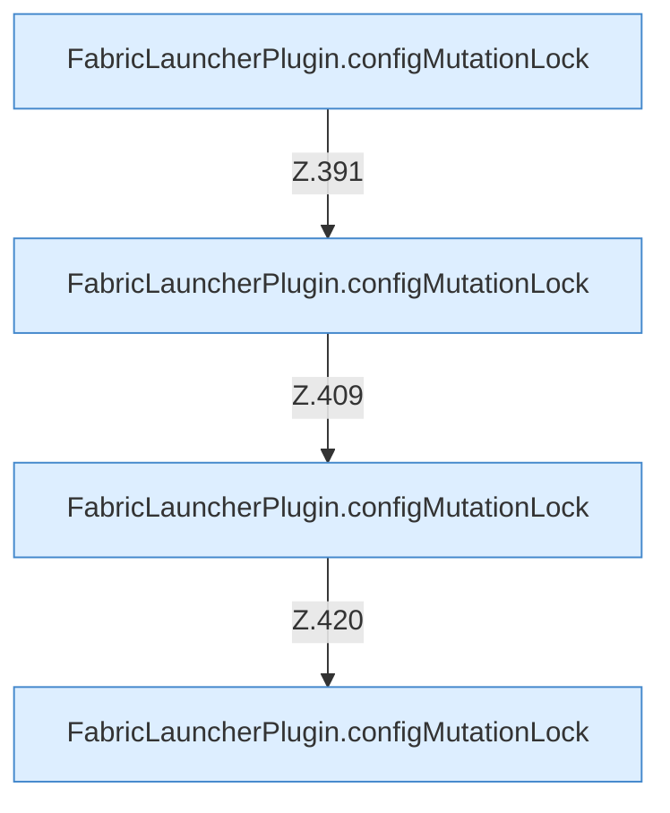

[[00 Start]] › [[Dashboard-HTTP]] › [[API-Zeit]] › [[Dashboard.schedulesApi]] › [[Dashboard.schedulesApi.Aufrufe]]

# Dashboard.schedulesApi.Aufrufe



```knoten
FabricLauncherPlugin.configMutationLock
  Sorgt dafür, dass nicht zwei Änderungen der [[Glossar#Einstellungen|Einstellungen]] gleichzeitig schreiben. `configMutationLock` in `FabricLauncherPlugin.java`.
```

> [!knoten]- Was die Blöcke tun
> - **FabricLauncherPlugin.configMutationLock**: Sorgt dafür, dass nicht zwei Änderungen der [[Glossar#Einstellungen|Einstellungen]] gleichzeitig schreiben. `configMutationLock` in `FabricLauncherPlugin.java`.

- Aufrufe, die das Diagramm nicht in den gezeichneten Ablauf gesetzt hat.
- Fortsetzung von `Dashboard.schedulesApi`.
- ungeprüft: Ablaufparser oder nachgetragene Aufrufe, siehe [[bericht]].
