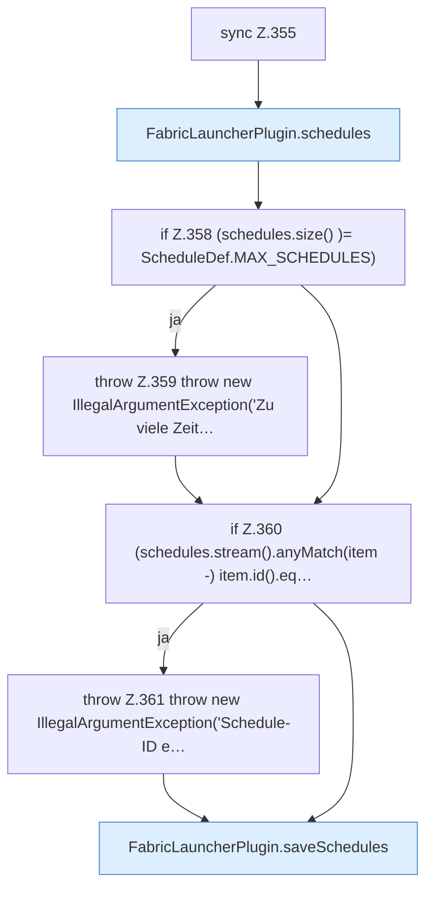

[[00 Start]] › [[Dashboard-HTTP]] › [[API-Zeit]] › [[Dashboard.schedulesApi]] › [[Dashboard.schedulesApi.Teil1.Z349.Z354.Z355]]

# Dashboard.schedulesApi.Teil1.Z349.Z354.Z355



```knoten
sync Z.355
  Zeile 355: synchronisierter Block.
FabricLauncherPlugin.schedules
  Das [[Glossar#Plugin|Plugin]] macht hier einen einzelnen Schritt. Eine Ebene tiefer steht er genauer. `schedules` in `FabricLauncherPlugin.java`. Ruft `load`.
if Z.358 (schedules.size() )= ScheduleDef.MAX_SCHEDULES)
  Zeile 358: prüft `(schedules.size() )= ScheduleDef.MAX_SCHEDULES)`.
throw Z.359 throw new IllegalArgumentException('Zu viele Zeit…
  Zeile 359: Abbruch `throw new IllegalArgumentException('Zu viele Zeit…`.
if Z.360 (schedules.stream().anyMatch(item -) item.id().eq…
  Zeile 360: prüft `(schedules.stream().anyMatch(item -) item.id().eq…`.
throw Z.361 throw new IllegalArgumentException('Schedule-ID e…
  Zeile 361: Abbruch `throw new IllegalArgumentException('Schedule-ID e…`.
FabricLauncherPlugin.saveSchedules
  Das [[Glossar#Plugin|Plugin]] speichert die Zeitpläne. Speichert `saveSchedules`. Ruft `toConfig`, `saveConfigWritable`.
```

> [!knoten]- Was die Blöcke tun
> - **sync Z.355**: Zeile 355: synchronisierter Block.
> - **FabricLauncherPlugin.schedules**: Das [[Glossar#Plugin|Plugin]] macht hier einen einzelnen Schritt. Eine Ebene tiefer steht er genauer. `schedules` in `FabricLauncherPlugin.java`. Ruft `load`.
> - **if Z.358 (schedules.size() )= ScheduleDef.MAX_SCHEDULES)**: Zeile 358: prüft `(schedules.size() )= ScheduleDef.MAX_SCHEDULES)`.
> - **throw Z.359 throw new IllegalArgumentException('Zu viele Zeit…**: Zeile 359: Abbruch `throw new IllegalArgumentException('Zu viele Zeit…`.
> - **if Z.360 (schedules.stream().anyMatch(item -) item.id().eq…**: Zeile 360: prüft `(schedules.stream().anyMatch(item -) item.id().eq…`.
> - **throw Z.361 throw new IllegalArgumentException('Schedule-ID e…**: Zeile 361: Abbruch `throw new IllegalArgumentException('Schedule-ID e…`.
> - **FabricLauncherPlugin.saveSchedules**: Das [[Glossar#Plugin|Plugin]] speichert die Zeitpläne. Speichert `saveSchedules`. Ruft `toConfig`, `saveConfigWritable`.

- Der Ablauf geht in [[Glossar#Zeile|Zeile]] 355 weiter. Eine Ebene tiefer steht er genauer.
- Fortsetzung von `Dashboard.schedulesApi.Teil1.Z349.Z354`.
