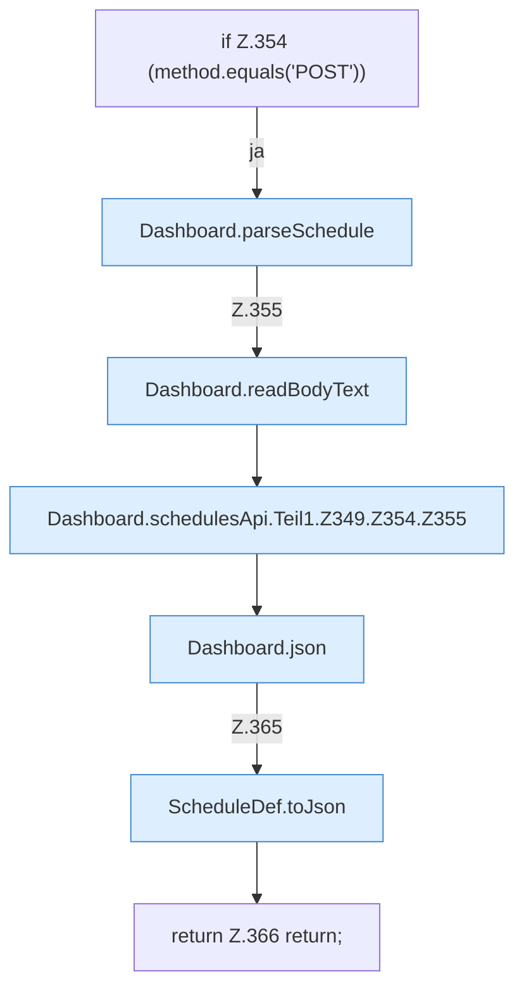

[[00 Start]] › [[Dashboard-HTTP]] › [[API-Zeit]] › [[Dashboard.schedulesApi]] › [[Dashboard.schedulesApi.Teil1.Z349.Z354]]

# Dashboard.schedulesApi.Teil1.Z349.Z354



```knoten
if Z.354 (method.equals('POST'))
  Zeile 354: prüft `(method.equals('POST'))`.
Dashboard.parseSchedule
  Wertet aus `parseSchedule`. Ruft `load`.
Dashboard.readBodyText
  Liest `readBodyText`.
Dashboard.schedulesApi.Teil1.Z349.Z354.Z355
  Fortsetzung des Ablaufs ab Zeile 355.
Dashboard.json
  Antwortet mit JSON `json`. Ruft `sendBytes`.
ScheduleDef.toJson
  `toJson` in `ScheduleDef.java`. Ruft `toConfig`, `cron`.
return Z.366 return;
  Zeile 366: Rückgabe `return;`.
```

- Fortsetzung von `Dashboard.schedulesApi.Teil1.Z349`, Quellreihenfolge.
