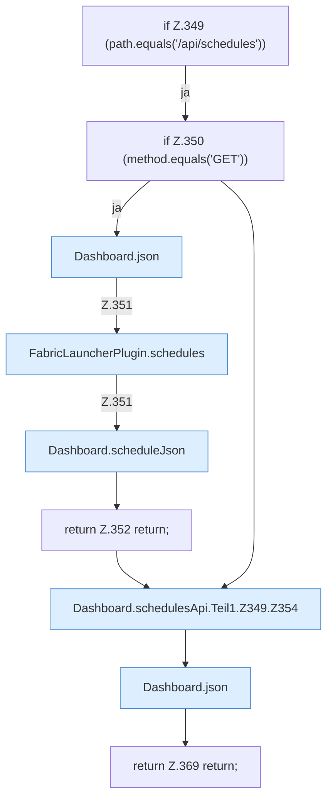

[[00 Start]] › [[Dashboard-HTTP]] › [[API-Zeit]] › [[Dashboard.schedulesApi]] › [[Dashboard.schedulesApi.Teil1.Z349]]

# Dashboard.schedulesApi.Teil1.Z349

- Fortsetzung von `Dashboard.schedulesApi.Teil1`, Quellreihenfolge.
