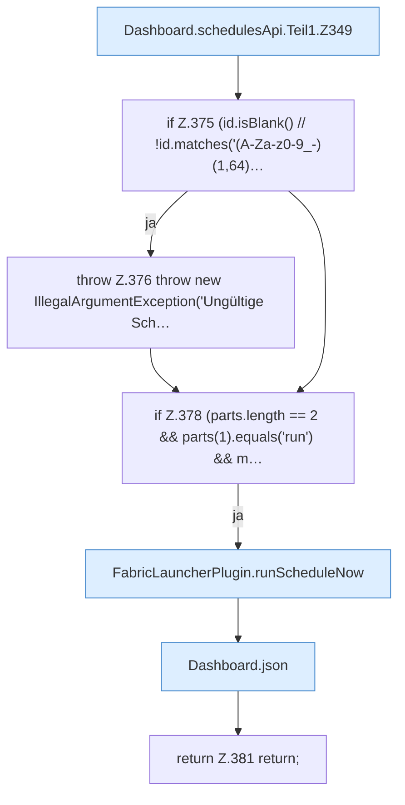

[[00 Start]] › [[Dashboard-HTTP]] › [[API-Zeit]] › [[Dashboard.schedulesApi]] › [[Dashboard.schedulesApi.Teil1]]

# Dashboard.schedulesApi.Teil1

- Fortsetzung von `Dashboard.schedulesApi`, Quellreihenfolge.
