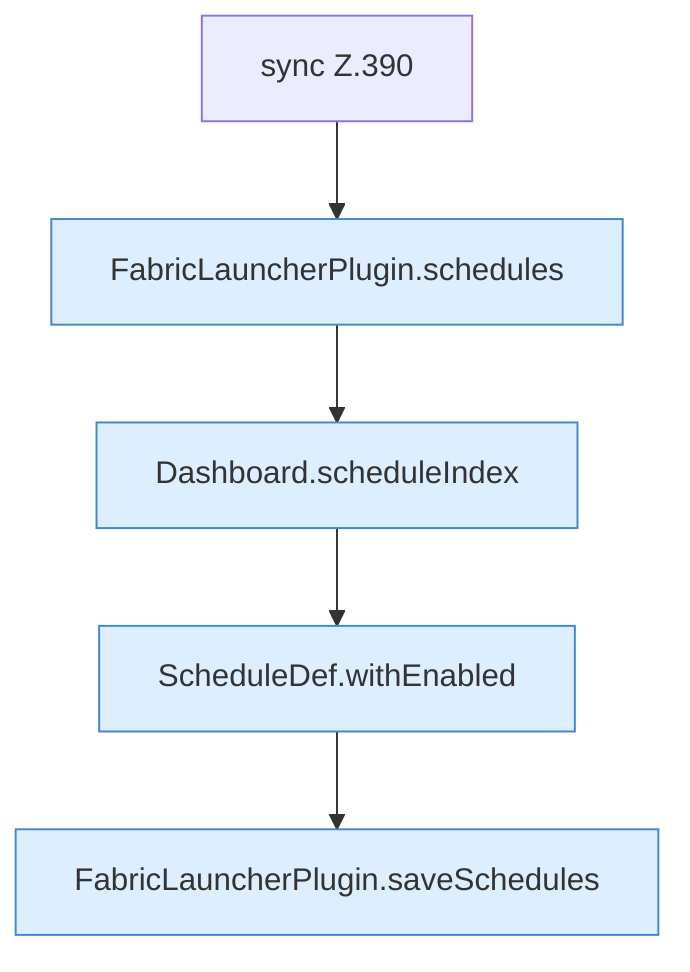

[[00 Start]] › [[Dashboard-HTTP]] › [[API-Zeit]] › [[Dashboard.schedulesApi]] › [[Dashboard.schedulesApi.Teil2.Z384.Z390]]

# Dashboard.schedulesApi.Teil2.Z384.Z390



```knoten
sync Z.390
  Zeile 390: synchronisierter Block.
FabricLauncherPlugin.schedules
  Das [[Glossar#Plugin|Plugin]] macht hier einen einzelnen Schritt. Eine Ebene tiefer steht er genauer. `schedules` in `FabricLauncherPlugin.java`. Ruft `load`.
Dashboard.scheduleIndex
  Die [[Glossar#Web-Schnittstelle|Web-Schnittstelle]] plant die Position. Plant `scheduleIndex`.
ScheduleDef.withEnabled
  Der [[Glossar#Zeitplan|Zeitplan]] macht hier einen einzelnen Schritt. Eine Ebene tiefer steht er genauer. Liefert eine Kopie mit `withEnabled`. Ruft `ScheduleDef`.
FabricLauncherPlugin.saveSchedules
  Das [[Glossar#Plugin|Plugin]] speichert die Zeitpläne. Speichert `saveSchedules`. Ruft `toConfig`, `saveConfigWritable`.
```

> [!knoten]- Was die Blöcke tun
> - **sync Z.390**: Zeile 390: synchronisierter Block.
> - **FabricLauncherPlugin.schedules**: Das [[Glossar#Plugin|Plugin]] macht hier einen einzelnen Schritt. Eine Ebene tiefer steht er genauer. `schedules` in `FabricLauncherPlugin.java`. Ruft `load`.
> - **Dashboard.scheduleIndex**: Die [[Glossar#Web-Schnittstelle|Web-Schnittstelle]] plant die Position. Plant `scheduleIndex`.
> - **ScheduleDef.withEnabled**: Der [[Glossar#Zeitplan|Zeitplan]] macht hier einen einzelnen Schritt. Eine Ebene tiefer steht er genauer. Liefert eine Kopie mit `withEnabled`. Ruft `ScheduleDef`.
> - **FabricLauncherPlugin.saveSchedules**: Das [[Glossar#Plugin|Plugin]] speichert die Zeitpläne. Speichert `saveSchedules`. Ruft `toConfig`, `saveConfigWritable`.

- Der Ablauf geht in [[Glossar#Zeile|Zeile]] 390 weiter. Eine Ebene tiefer steht er genauer.
- Fortsetzung von `Dashboard.schedulesApi.Teil2.Z384`.
