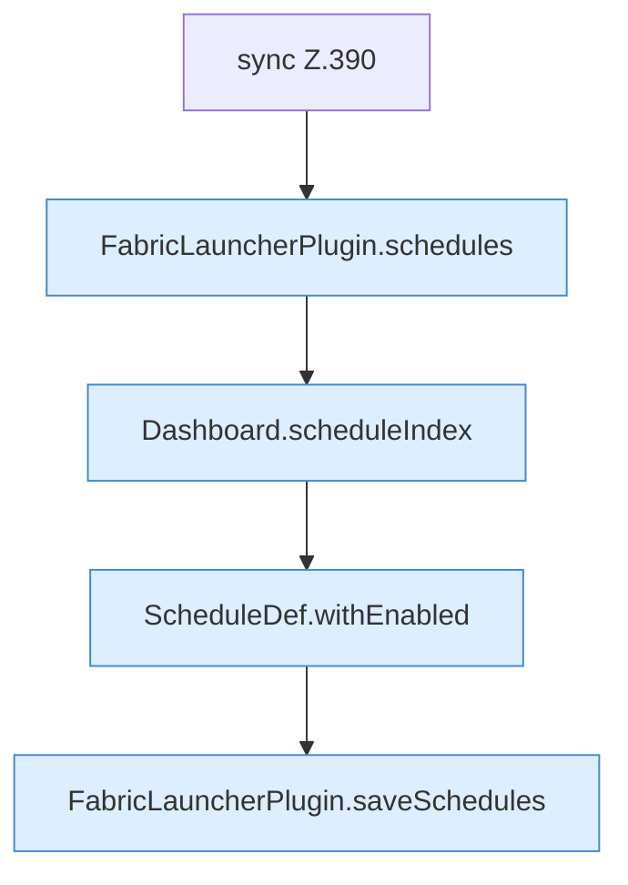

[[00 Start]] › [[Dashboard-HTTP]] › [[API-Zeit]] › [[Dashboard.schedulesApi]] › [[Dashboard.schedulesApi.Teil2.Z384.Z390]]

# Dashboard.schedulesApi.Teil2.Z384.Z390



```knoten
sync Z.390
  Zeile 390: synchronisierter Block.
FabricLauncherPlugin.schedules
  `schedules` in `FabricLauncherPlugin.java`. Ruft `load`.
Dashboard.scheduleIndex
  Plant `scheduleIndex`.
ScheduleDef.withEnabled
  Liefert eine Kopie mit `withEnabled`. Ruft `ScheduleDef`.
FabricLauncherPlugin.saveSchedules
  Speichert `saveSchedules`. Ruft `toConfig`, `saveConfigWritable`.
```

- Fortsetzung von `Dashboard.schedulesApi.Teil2.Z384`, Quellreihenfolge.
