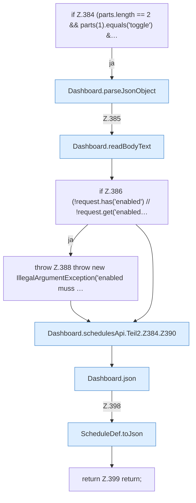

[[00 Start]] › [[Dashboard-HTTP]] › [[API-Zeit]] › [[Dashboard.schedulesApi]] › [[Dashboard.schedulesApi.Teil2.Z384]]

# Dashboard.schedulesApi.Teil2.Z384



```knoten
if Z.384 (parts.length == 2 && parts(1).equals('toggle') &…
  Zeile 384: prüft `(parts.length == 2 && parts(1).equals('toggle') &…`.
Dashboard.parseJsonObject
  Die [[Glossar#Web-Schnittstelle|Web-Schnittstelle]] liest die Antwort den Inhalt. Wertet aus `parseJsonObject`.
Dashboard.readBodyText
  Die [[Glossar#Web-Schnittstelle|Web-Schnittstelle]] liest den Text den Text. Liest `readBodyText`.
if Z.386 (!request.has('enabled') // !request.get('enabled…
  Zeile 386: prüft `(!request.has('enabled') // !request.get('enabled…`.
throw Z.388 throw new IllegalArgumentException('enabled muss …
  Zeile 388: Abbruch `throw new IllegalArgumentException('enabled muss …`.
Dashboard.schedulesApi.Teil2.Z384.Z390
  Der Ablauf geht in [[Glossar#Zeile|Zeile]] 390 weiter. Eine Ebene tiefer steht er genauer. Fortsetzung des Ablaufs ab Zeile 390.
Dashboard.json
  Die [[Glossar#Web-Schnittstelle|Web-Schnittstelle]] macht hier einen einzelnen Schritt. Eine Ebene tiefer steht er genauer. Antwortet mit JSON `json`. Ruft `sendBytes`.
ScheduleDef.toJson
  Der [[Glossar#Zeitplan|Zeitplan]] kümmert sich um die Antwort. `toJson` in `ScheduleDef.java`. Ruft `toConfig`, `cron`.
return Z.399 return;
  Zeile 399: Rückgabe `return;`.
```

> [!knoten]- Was die Blöcke tun
> - **if Z.384 (parts.length == 2 && parts(1).equals('toggle') &…**: Zeile 384: prüft `(parts.length == 2 && parts(1).equals('toggle') &…`.
> - **Dashboard.parseJsonObject**: Die [[Glossar#Web-Schnittstelle|Web-Schnittstelle]] liest die Antwort den Inhalt. Wertet aus `parseJsonObject`.
> - **Dashboard.readBodyText**: Die [[Glossar#Web-Schnittstelle|Web-Schnittstelle]] liest den Text den Text. Liest `readBodyText`.
> - **if Z.386 (!request.has('enabled') // !request.get('enabled…**: Zeile 386: prüft `(!request.has('enabled') // !request.get('enabled…`.
> - **throw Z.388 throw new IllegalArgumentException('enabled muss …**: Zeile 388: Abbruch `throw new IllegalArgumentException('enabled muss …`.
> - **Dashboard.schedulesApi.Teil2.Z384.Z390**: Der Ablauf geht in [[Glossar#Zeile|Zeile]] 390 weiter. Eine Ebene tiefer steht er genauer. Fortsetzung des Ablaufs ab Zeile 390.
> - **Dashboard.json**: Die [[Glossar#Web-Schnittstelle|Web-Schnittstelle]] macht hier einen einzelnen Schritt. Eine Ebene tiefer steht er genauer. Antwortet mit JSON `json`. Ruft `sendBytes`.
> - **ScheduleDef.toJson**: Der [[Glossar#Zeitplan|Zeitplan]] kümmert sich um die Antwort. `toJson` in `ScheduleDef.java`. Ruft `toConfig`, `cron`.
> - **return Z.399 return;**: Zeile 399: Rückgabe `return;`.

- Der Ablauf geht in [[Glossar#Zeile|Zeile]] 384 weiter. Eine Ebene tiefer steht er genauer.
- Fortsetzung von `Dashboard.schedulesApi.Teil2`.
