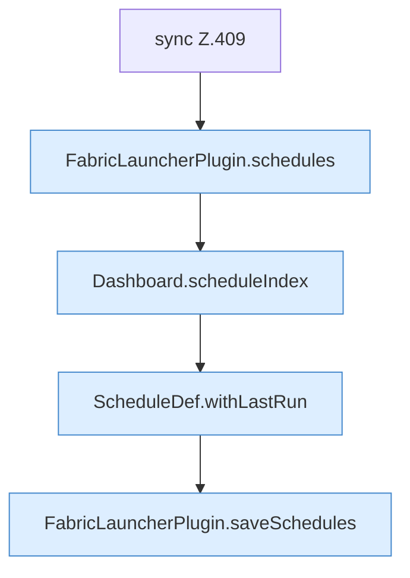

[[00 Start]] › [[Dashboard-HTTP]] › [[API-Zeit]] › [[Dashboard.schedulesApi]] › [[Dashboard.schedulesApi.Teil2.Z406.Z409]]

# Dashboard.schedulesApi.Teil2.Z406.Z409



```knoten
sync Z.409
  Zeile 409: synchronisierter Block.
FabricLauncherPlugin.schedules
  `schedules` in `FabricLauncherPlugin.java`. Ruft `load`.
Dashboard.scheduleIndex
  Plant `scheduleIndex`.
ScheduleDef.withLastRun
  Liefert eine Kopie mit `withLastRun`. Ruft `ScheduleDef`.
FabricLauncherPlugin.saveSchedules
  Speichert `saveSchedules`. Ruft `toConfig`, `saveConfigWritable`.
```

- Fortsetzung von `Dashboard.schedulesApi.Teil2.Z406`, Quellreihenfolge.
