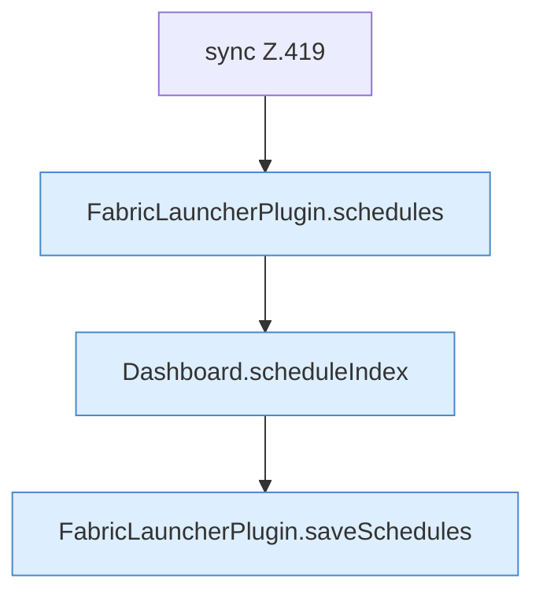

[[00 Start]] › [[Dashboard-HTTP]] › [[API-Zeit]] › [[Dashboard.schedulesApi]] › [[Dashboard.schedulesApi.Teil2.Z419.Z419]]

# Dashboard.schedulesApi.Teil2.Z419.Z419



```knoten
sync Z.419
  Zeile 419: synchronisierter Block.
FabricLauncherPlugin.schedules
  Das [[Glossar#Plugin|Plugin]] macht hier einen einzelnen Schritt. Eine Ebene tiefer steht er genauer. `schedules` in `FabricLauncherPlugin.java`. Ruft `load`.
Dashboard.scheduleIndex
  Die [[Glossar#Web-Schnittstelle|Web-Schnittstelle]] plant die Position. Plant `scheduleIndex`.
FabricLauncherPlugin.saveSchedules
  Das [[Glossar#Plugin|Plugin]] speichert die Zeitpläne. Speichert `saveSchedules`. Ruft `toConfig`, `saveConfigWritable`.
```

> [!knoten]- Was die Blöcke tun
> - **sync Z.419**: Zeile 419: synchronisierter Block.
> - **FabricLauncherPlugin.schedules**: Das [[Glossar#Plugin|Plugin]] macht hier einen einzelnen Schritt. Eine Ebene tiefer steht er genauer. `schedules` in `FabricLauncherPlugin.java`. Ruft `load`.
> - **Dashboard.scheduleIndex**: Die [[Glossar#Web-Schnittstelle|Web-Schnittstelle]] plant die Position. Plant `scheduleIndex`.
> - **FabricLauncherPlugin.saveSchedules**: Das [[Glossar#Plugin|Plugin]] speichert die Zeitpläne. Speichert `saveSchedules`. Ruft `toConfig`, `saveConfigWritable`.

- Der Ablauf geht in [[Glossar#Zeile|Zeile]] 419 weiter. Eine Ebene tiefer steht er genauer.
- Fortsetzung von `Dashboard.schedulesApi.Teil2.Z419`.
