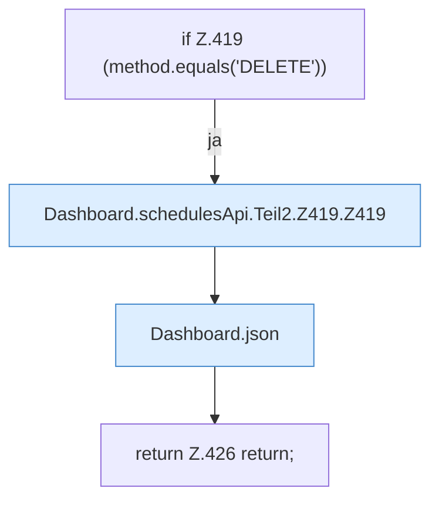

[[00 Start]] › [[Dashboard-HTTP]] › [[API-Zeit]] › [[Dashboard.schedulesApi]] › [[Dashboard.schedulesApi.Teil2.Z419]]

# Dashboard.schedulesApi.Teil2.Z419

- Fortsetzung von `Dashboard.schedulesApi.Teil2`, Quellreihenfolge.
