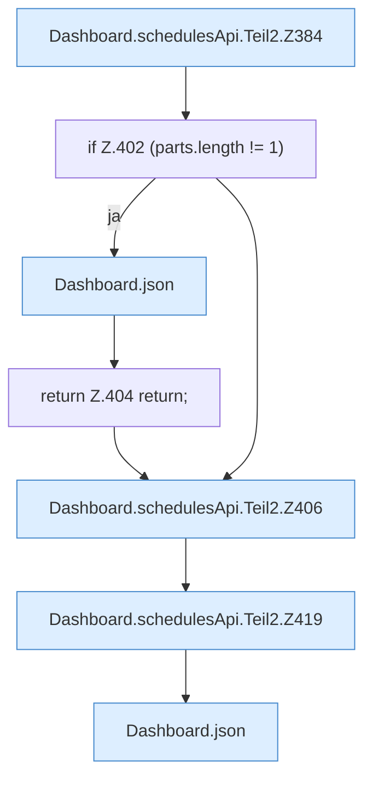

[[00 Start]] › [[Dashboard-HTTP]] › [[API-Zeit]] › [[Dashboard.schedulesApi]] › [[Dashboard.schedulesApi.Teil2]]

# Dashboard.schedulesApi.Teil2



```knoten
Dashboard.schedulesApi.Teil2.Z384
  Der Ablauf geht in [[Glossar#Zeile|Zeile]] 384 weiter. Eine Ebene tiefer steht er genauer. Fortsetzung des Ablaufs ab Zeile 384.
if Z.402 (parts.length != 1)
  Zeile 402: prüft `(parts.length != 1)`.
Dashboard.json
  Die [[Glossar#Web-Schnittstelle|Web-Schnittstelle]] macht hier einen einzelnen Schritt. Eine Ebene tiefer steht er genauer. Antwortet mit JSON `json`. Ruft `sendBytes`.
return Z.404 return;
  Zeile 404: Rückgabe `return;`.
Dashboard.schedulesApi.Teil2.Z406
  Der Ablauf geht in [[Glossar#Zeile|Zeile]] 406 weiter. Eine Ebene tiefer steht er genauer. Fortsetzung des Ablaufs ab Zeile 406.
Dashboard.schedulesApi.Teil2.Z419
  Der Ablauf geht in [[Glossar#Zeile|Zeile]] 419 weiter. Eine Ebene tiefer steht er genauer. Fortsetzung des Ablaufs ab Zeile 419.
```

> [!knoten]- Was die Blöcke tun
> - **Dashboard.schedulesApi.Teil2.Z384**: Der Ablauf geht in [[Glossar#Zeile|Zeile]] 384 weiter. Eine Ebene tiefer steht er genauer. Fortsetzung des Ablaufs ab Zeile 384.
> - **if Z.402 (parts.length != 1)**: Zeile 402: prüft `(parts.length != 1)`.
> - **Dashboard.json**: Die [[Glossar#Web-Schnittstelle|Web-Schnittstelle]] macht hier einen einzelnen Schritt. Eine Ebene tiefer steht er genauer. Antwortet mit JSON `json`. Ruft `sendBytes`.
> - **return Z.404 return;**: Zeile 404: Rückgabe `return;`.
> - **Dashboard.schedulesApi.Teil2.Z406**: Der Ablauf geht in [[Glossar#Zeile|Zeile]] 406 weiter. Eine Ebene tiefer steht er genauer. Fortsetzung des Ablaufs ab Zeile 406.
> - **Dashboard.schedulesApi.Teil2.Z419**: Der Ablauf geht in [[Glossar#Zeile|Zeile]] 419 weiter. Eine Ebene tiefer steht er genauer. Fortsetzung des Ablaufs ab Zeile 419.

- Ein weiterer Abschnitt derselben Übersicht.
- Fortsetzung von `Dashboard.schedulesApi`.
