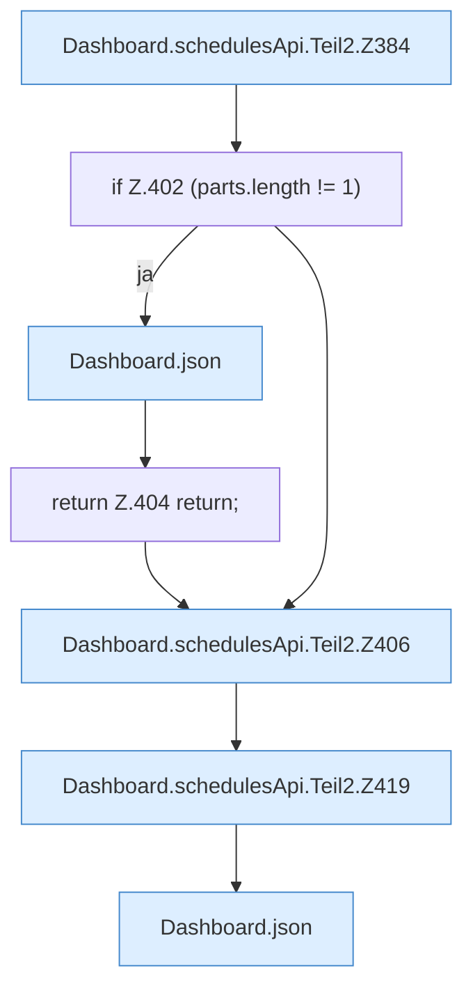

[[00 Start]] › [[Dashboard-HTTP]] › [[API-Zeit]] › [[Dashboard.schedulesApi]] › [[Dashboard.schedulesApi.Teil2]]

# Dashboard.schedulesApi.Teil2

- Fortsetzung von `Dashboard.schedulesApi`, Quellreihenfolge.
