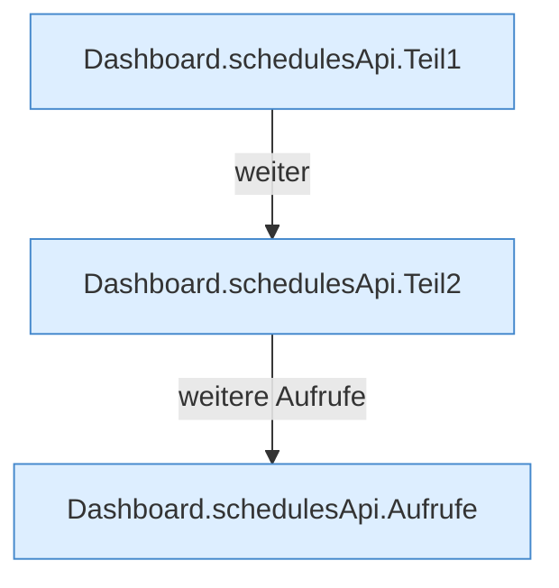

[[00 Start]] › [[Dashboard-HTTP]] › [[API-Zeit]] › [[Dashboard.schedulesApi]]

# Dashboard.schedulesApi

`Dashboard.schedulesApi(HttpExchange ex, String method, String path)` [src/main/java/de/aichele/childlauncher/Dashboard.java:348–429](https://github.com/Sciddie/minecraft-serverhoster-plugin/blob/95b02b953b0b4c23673e900e021a7c3c844aa37d/src/main/java/de/aichele/childlauncher/Dashboard.java#L348-L429)

- `schedulesApi` in `src/main/java/de/aichele/childlauncher/Dashboard.java`
- ungeprüft: Ablaufparser oder nachgetragene Aufrufe, siehe [[bericht]].
